# Apple\_us\_register



## 打开苹果账户注册页面

访问 Apple 官方注册入口：

[https](https://account.apple.com/account)[://account.apple.com/account](https://account.apple.com/account)

填写注册信息时请注意：

* **国家或地区**：务必选择 **美国（United States）**
* 其他个人信息可正常填写
* **邮箱**：必须能正常接收验证码（后续邮箱验证用。QQ 邮箱刚看了一下好像不可以。可以申请个别的，比如 126 邮箱）
* **手机号**：可使用中国大陆手机号，能接收短信即可

_填写页面示例：_

<figure>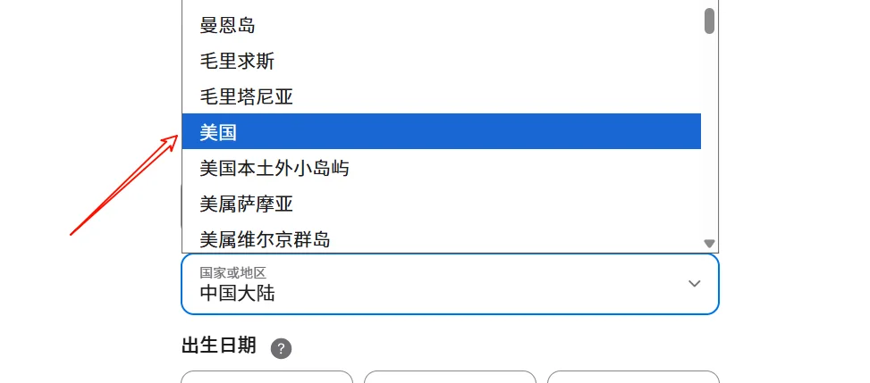<figcaption></figcaption></figure> <figure>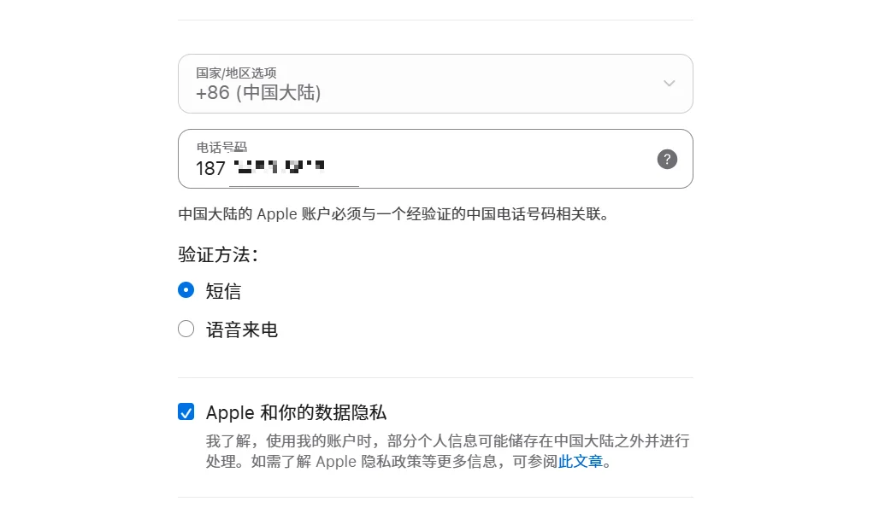<figcaption></figcaption></figure>




## 验证邮箱与手机号

注册完成后，系统会依次要求验证邮箱与手机号：

* **邮箱验证**：前往邮箱查收 Apple 验证码

<figure>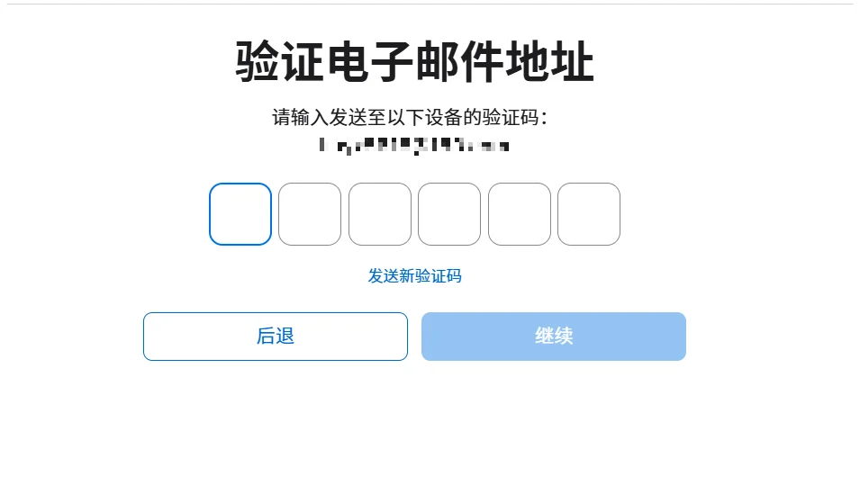<figcaption></figcaption></figure>

* **手机号验证**：手机收到短信验证码后输入即可

<figure>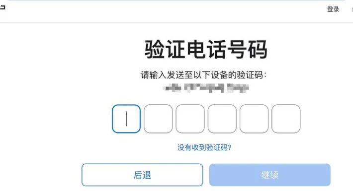<figcaption></figcaption></figure>

验证成功后，将出现 Apple 账户创建成功页面。

_验证页面示例：_

<figure>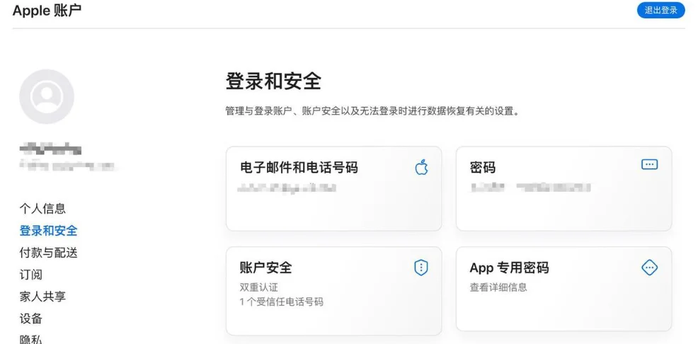<figcaption></figcaption></figure>



## 添加美国配送地址（最好弄一下）

注册完成后，进入账户后台：

<figure>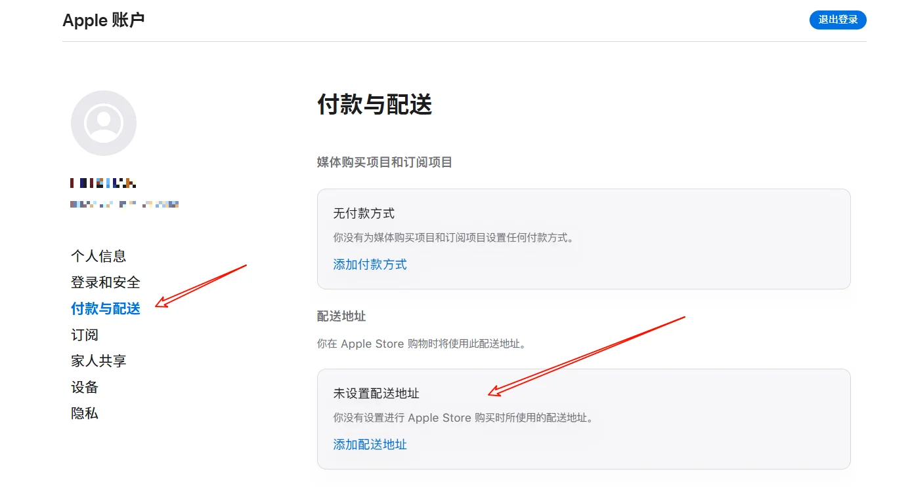<figcaption></figcaption></figure>

打开 **「付款与配送」** → 点击 **「添加地址」**

此时需要生成一份有效的美国地址。

**地址生成网站：**

[美国身份证生成，美国人地址信息生成-世界各国身份信息、地址、信用卡生成器](https://www.shenfendaquan.com/)：https://www.shenfendaquan.com/

上面的网站比较慢的话，可以试试这个：

https://1ktools.com/zh-cn/tools/developer/us-tax-free-address-generator

在网站中选择以下 **免税州之一**（可避免后续购买应用时税费）：

* Alaska（阿拉斯加州）
* Montana（蒙大拿州）
* Oregon（俄勒冈州）
* Delaware（特拉华州）


_建议使用 Alaska 地址，最稳定且无税收。_

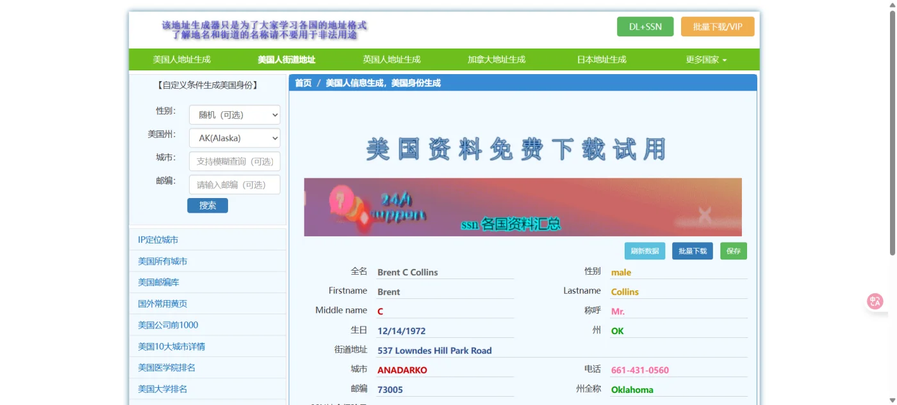


填写完毕后点击 **「保存更改」** 即可。

_地址填写示例：_

<figure>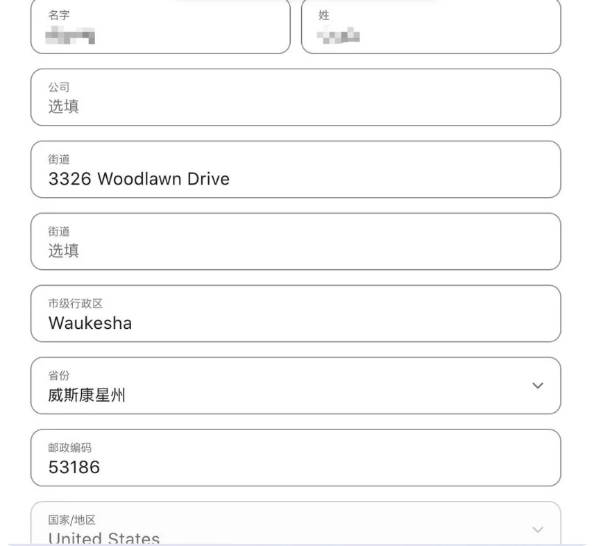<figcaption></figcaption></figure>



## 登录新的美区 Apple ID

### 旧版

iPhone 上退出原有账户：

前往「App Store」 → 「点击头像」 → 「退出登录」

<figure>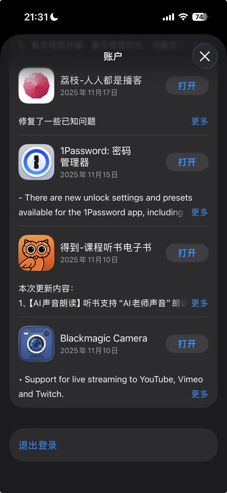<figcaption></figcaption></figure>

使用刚注册好的 **美区 Apple ID** 登录。

### 新版

进入设置，如下所示：

<figure>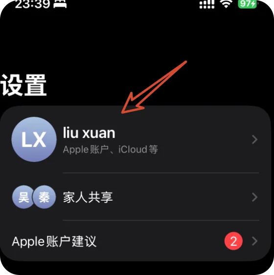<figcaption></figcaption></figure> <figure>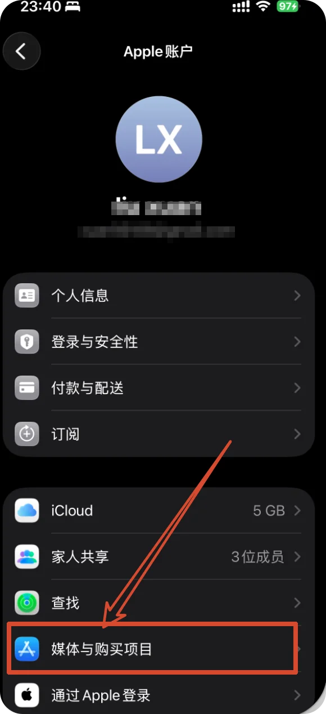<figcaption></figcaption></figure> <figure>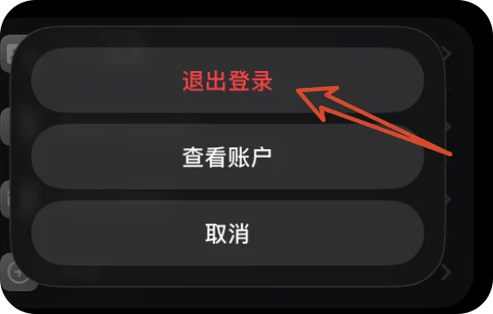<figcaption></figcaption></figure>

### 登录

<figure>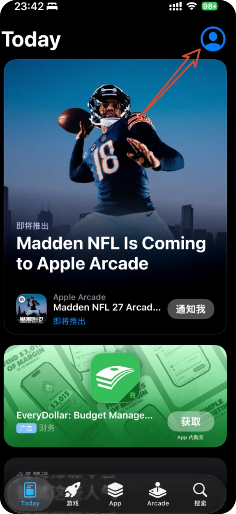<figcaption></figcaption></figure> <figure>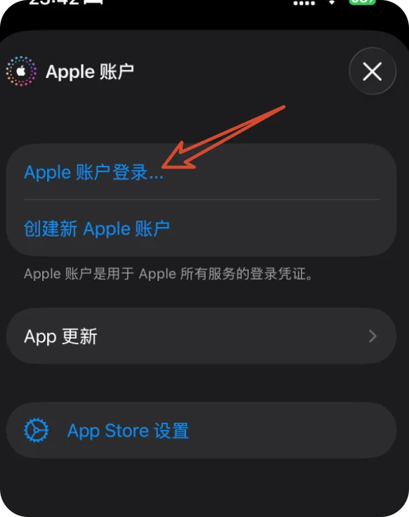<figcaption></figcaption></figure> <figure>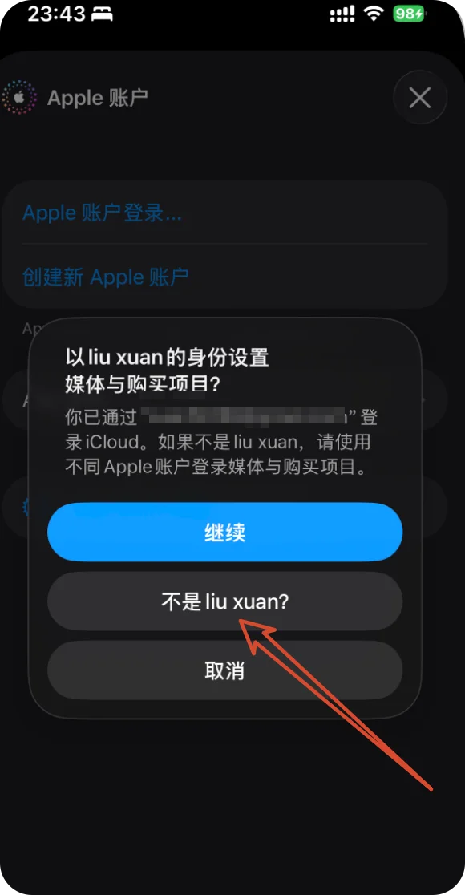<figcaption></figcaption></figure>




## App Store 进入美区应用商店

完成登录后，你将看到 **美区应用页面**。此时即可自由下载 ChatGPT、Perplexity、TestFlight、Midjourney Viewer 等海外独占 App。

_美区 App Store 页面示例：_

<figure>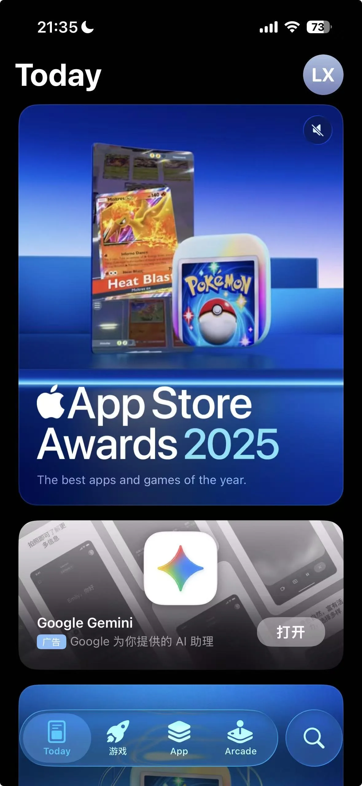<figcaption></figcaption></figure>



## 礼品卡购买（可不做）

此处使用渠道为：支付宝的 pockytshop 小程序（可支付宝登录）

<figure>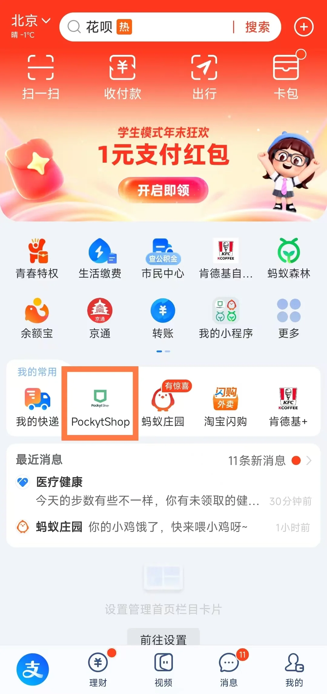<figcaption></figcaption></figure> <figure>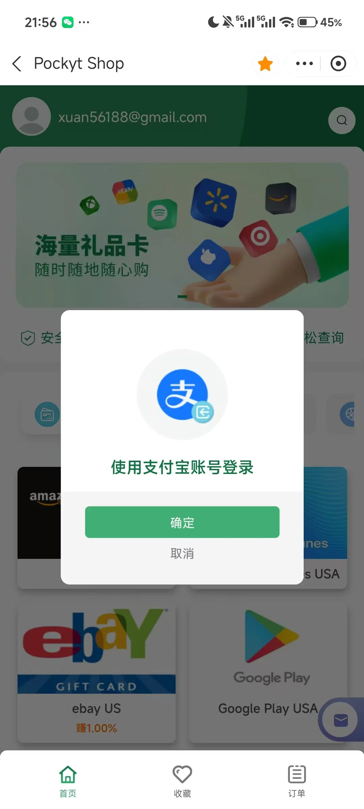<figcaption></figcaption></figure> <figure>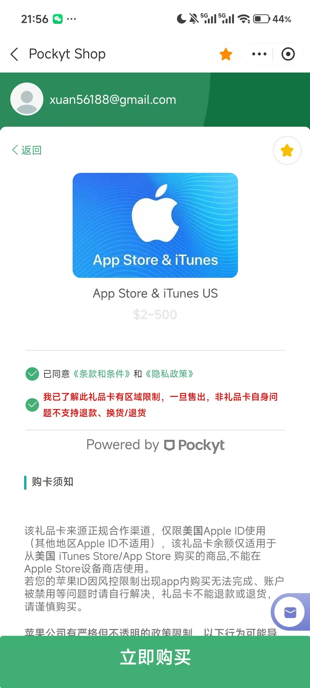<figcaption></figcaption></figure>

<figure><figcaption></figcaption></figure>




## 常见问题（FAQ）

是否可以用中国手机号注册？

✅ 可以，确保能接收短信验证码即可。

邮箱必须用 Gmail 吗？

非必须，163/Outlook/QQ 邮箱都可。

需要绑定信用卡吗？

不需要，可选择「无支付方式」。

地址必须真实有效吗？

是的，建议使用生成器提供的免税州地址。

如何切回国区账号？

在设置中退出美区账号，再登录原中国区 ID。App Store 中的话，可以直接退出，然后使用设置中的账号登录。

账号换区咋弄？

### 使用 iPhone、iPad 或 Apple Vision Pro 来更改地区设置



## 打开“设置”App



## 轻点你的姓名，然后轻点“媒体与购买项目”



## 轻点“显示账户”

系统可能会要求你登录。



## 轻点“国家/地区”



## 选择新国家或地区



## 轻点“更改国家或地区”



## 轻点新国家或地区，然后查看“条款与条件”



## 轻点右上角的“同意”，然后再次轻点“同意”以确认



## 选择付款方式

输入你的新付款信息和账单邮寄地址，然后轻点“下一步”。你必须输入适用于所在新国家或地区的有效付款方式\*。



详细可参考 ： https://support.apple.com/zh-cn/118283

### 使用 Mac 或 Windows PC 更改你所在的地区



## 打开 Apple Music App 或 Apple TV App



## 打开账户设置

在 Mac 上，在菜单栏中，选取“账户”>“账户设置”。在 Windows PC 上，在边栏底部点按你的姓名，然后点按“查看我的账户”。



## 登录你的 Apple 账户

你可能需要登录你的 Apple 账户。



## 点按“更改国家或地区”

在“账户信息”页面，点按“更改国家或地区”。



## 选择新国家或地区



## 查看“条款与条件”

然后点按“同意”。再次点按“同意”以确认。



## 输入新付款信息和账单邮寄地址

然后点按“继续”。



### 在线更改地区设置



## 登录 [account.apple.com](https://account.apple.com/)



## 轻点或点按“个人信息”



## 轻点或点按“国家或地区”



## 按照屏幕上的说明操作

你必须输入适用于所在新国家或地区的有效付款方式\*。



### 如果无法更改的国家或地区设置

* 如果你无法更改国家或地区，请确保你已取消各项订阅并用完了账户余额。[尝试更改国家或地区之前，请完成这些步骤](https://support.apple.com/zh-cn/118283#qualifications)。
* 如果你是“家人共享”群组的成员，你可能无法更改你所在的国家或地区。[了解如何退出“家人共享”群组](https://support.apple.com/zh-cn/102652)。
* 如果你的商店余额低于单个项目的价格，请[联系 Apple 支持](https://getsupport.apple.com/?caller=kbase)。
* 如果你不想输入付款方式，请等你到了新的国家或地区后，再[创建新的 Apple 账户](https://support.apple.com/zh-cn/108647)。

礼品卡有啥用？

比如，充值 GPT Plus，Pro 的时候可以使用。首先需要在 IPhone 手机登录 chatGPT，随后点击升级到 plus，这个时候，可以走苹果余额订阅。这里可以自行操作一下。

这也是为什么要开美区账号的重要原因～

