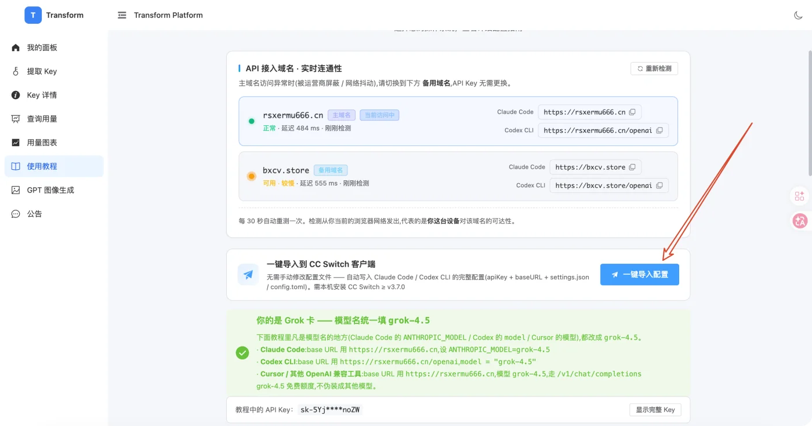
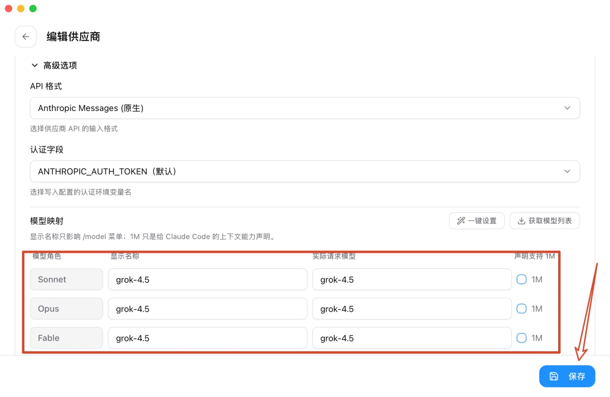
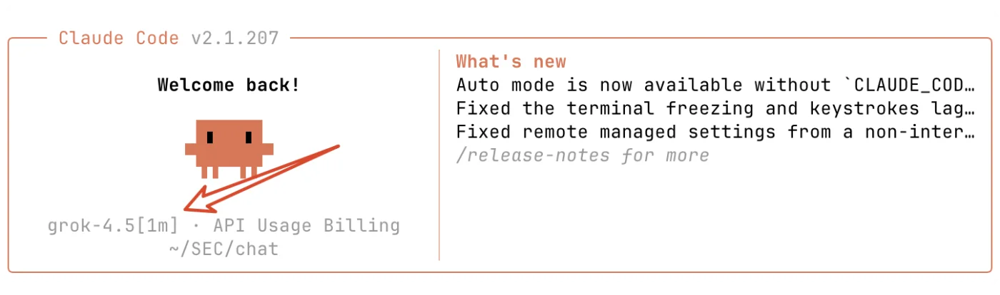

# 附录

存档：已停售的 Grok、失效的旧脚本、旧站点，以及两篇关于 Mac 的长文。返回[总览](README.md)。

## Grok（已停售）

> 官方不当人，套壳 composer 2.5，不卖了先。不影响原来开通的用户。

以下步骤存档备查。




### 导入配置

提取激活码，并来到 使用教程 页面，导入配置。




### 添加模型

导入配置后，来到 高级选项，将 `grok-4.5` 输入模型的列表内，保存即可。




### 重启 Claude code

再重启一个 Claude code 窗口，即可发现模型已变为 `grok-4.5`。









## 旧版用量查询脚本（已失效）

旧站点的接口，留档备查。

```
({
  request: {
    url: "{{baseUrl}}/api/user/key-info",
    method: "POST",
    headers: {
      "Content-Type": "application/json",
      "User-Agent": "cc-switch/1.0"
    },
    body: JSON.stringify({
      "key": "{{apiKey}}"
    })
  },
  extractor: function(response) {
    // 接口返回code不为200直接判定失效
    if (response.code !== 200) {
      return {
        isValid: false,
        invalidMessage: `接口请求失败，code:${response.code}`
      }
    }
    const data = response.data;
    // status=1 密钥正常
    const isValid = data.status === 1;
    let invalidMessage = "";
    if (!isValid) {
      invalidMessage = `密钥状态：${data.status_text || "未知状态"}`;
    }
    return {
      isValid: isValid,
      invalidMessage: invalidMessage,
      remaining: data.total_quota_usd - data.used_quota_usd,
      unit: "USD",
      planName: data.product_type,
      total: data.total_quota_usd,
      used: data.used_quota_usd,
      extra: `请求次数:${data.request_count}, Token总量:${data.total_tokens}`
    };
  }
})
```

## 旧站点（已停用）

~~<https://rsxermu666.cn/usage>~~

## 其实，我更推荐 MAC

<https://mp.weixin.qq.com/s/J8ErjDammtu7l6sRSD8AJQ>

原文贴在下面（原文未标注作者与发布日期）：

```
真想 Vibe？花点钱买个 Mac

下午 Vibe 群里又在讨论在 Windows 上做 Vibe Coding 遇到的问题。我说，建议换个 Mac 电脑。
以前我就讲过，开发者到底该用什么电脑。现在的问题变成了，AI 时代，Viber 应该用什么电脑。

如果你只是浏览网页写文档看视频做 PPT，这个答案没那么重要。但是，如果你想长期做 Vibe Coding，把 AI 编程工具放进日常工作流里——哪怕是给自己做产品——Mac 依然是综合体验最优的选择。

AI 开发离不开各种命令行、Python、Git、SSH、Node.js、Docker 和各种包管理工具。macOS 底层是 Unix 系统，这个我们之前说过很多次，终端、脚本、权限、管道、开发工具链，天然符合编程世界的默认值，Agent 帮你安装不说，你遇到的问题，基本已经被产品在发布之前解决过了。

Windows 可没这个待遇。

Vibe Coding 看起来是聊聊天，实际很依赖环境。AI 可以生成代码，但项目得跑起来才能测试和使用，Agent 其实是很依赖本地工具链的。很多时候你的灵气都被折腾环境和遇到的问题给消耗光了。我见过不少用户被 Windows 环境折腾得半死，结论是： Vibe 真不靠谱啊。

工具生态一直是 Mac 的长期复利，你看看国外那些优秀的项目和工具，基本都是「优先满足」 Mac 用户的需求，包括 Claude Code、Codex、Dia 这样的 AI 产品，产品构建者本身都是 Mac 用户，他们当然更在意自己的使用感受。

除此之外，像终端工具、Homebrew、VS Code、Cursor、GitHub Copilot、Alfred，这些工具一直在 macOS 上生机勃勃，打磨多年，它们高效且稳定。Viber 打开 Mac，用 Alfred 快速呼起一个 Agent 工具，进入项目，Vibe Coding，跑服务测试，提交代码，整个过程可以做到一气呵成。

优秀的 AI 编程者显然更注重工程能力，他们注意力已经转向了需求、架构、验证和产品判断。这个时候，一台稳定、顺手、少打扰的电脑，价值真的会被放大。好的工具不会替代思考，但能减少无意义的消耗。

另外，苹果的 M 系列芯片安静、低功耗、续航长，统一内存架构也让本地推理更有空间。有跑本地模型需求的用户更应该关注 Mac。Apple Silicon 把 CPU、GPU 和内存放进同一套架构里，跑量化模型、调试本地 Agent、做隐私敏感任务，都更自然。

Mac 显然比其他电脑更贵一些。但是对 Viber 来说，它更像一项长期投资。我的原则：是每天都在用的东西，尽可能用最好的最有效率的。

屠龙刀还是废铁，取决于使用者。
```

<https://mp.weixin.qq.com/s/4Yvhs0WCNB-mlof3qp_UGQ>

```
爬上来说几点，大部分人不知道的反常识。

1. 学 AI 到底要不要换电脑? Mac 和 Win 怎么选？

最近星球新加了不少球友，很多人问我这个问题。我的建议是：
有条件直接上 Mac，暂时是 Win 也别急着换，先把 AI 用起来再说。

十年前我做安卓开发的时候就一直推荐 Mac，不是因为它贵就是好，而是 Mac 属于 Unix 系统，内存管理和命令行环境天生为开发而生。Win 在这两块很弱。

2. AI 对电脑的要求高么？

其实如果你不做音视频处理，以及跑本地模型，大部分情况内存是最主要的，这玩意没上限，越大越好，但是 AI 时代最低要求我认为起码得 16G, 32G 算是标配了。

当然，有条件，内存越大越好。

3. 桌面版和 cli 的区别是啥？

Codex 和 cc 都有桌面版和 cli。

cli 就是在终端里敲，开销最小、启动最快、占用资源最少，我开一个窗口直接就开干。

桌面版是图形界面，能可视化看改动、并行盯多个任务、还支持 Computer Use 这些，功能更强——但这些都是拿系统资源换来的。

尤其 Codex 桌面版，简直是吃内存大户，很多人用的时候一个最大的感受是卡，而且长时间跑大型项目经常内存爆掉。

原因一是基于 Electron 架构，这个架构你可以理解为包了一层 chrome，优点是跨系统，但是缺点也很明显，对内存占用是原生应用的两三倍，第二个 Codex 桌面版有内存泄露 bug，现在都还没修复。

所以如果你电脑配置不够高，第一决策不一定是换新电脑，可以考虑直接用 cli，我那台老旧 Mac 电脑 8G 内存完全 cli 开发一点问题都没。

值得提的是，不管是桌面版和 cli，cc/codex 都是共用一套系统配置。

4. AI 时代，cli 真没那么极客

很多人一看终端就怕，觉得那是程序员专属。

如果是十年前，那终端确实是技术人和极客专属，自己手动敲代码、敲命令。

但是 AI 时代，终端使用的门槛极大降低。

比如很多人看过我直播，我是一直习惯 cli，但是我也是一行代码不写，就是在一个对话框里用大白话让 AI 干活，跟你在桌面版里说人话几乎没区别。

终端早就不是极客的门槛了。

你不会的命令，AI 都会。

给自己一周时间，基本就习惯了。

别纠结设备、别怕终端——先用起来，才是这个时代最重要的事。
```

## 外部教程

外面一份卖 20 - 50 不等，实际是开源的文档。链接：<https://coding.stormzhang.ai/>

Codex 破甲：

- <https://yynxxxxx.github.io/Codex-X/#hero>
- <https://github.com/zxr-roro/GPT5.6-5.5-/blob/main/zzy-codex5.6/>
