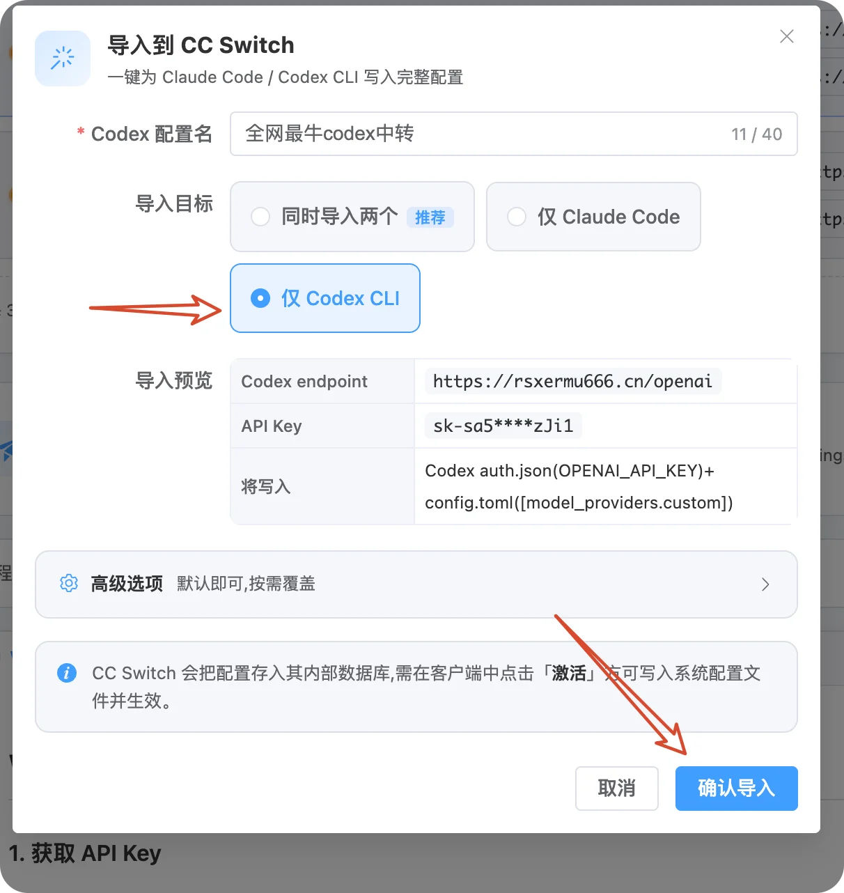
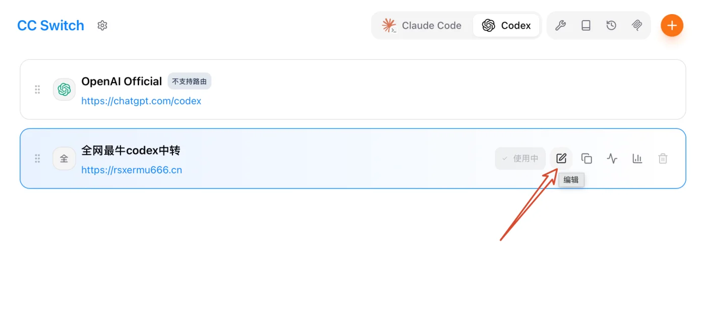
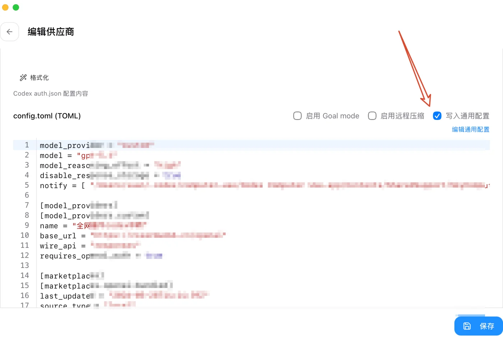
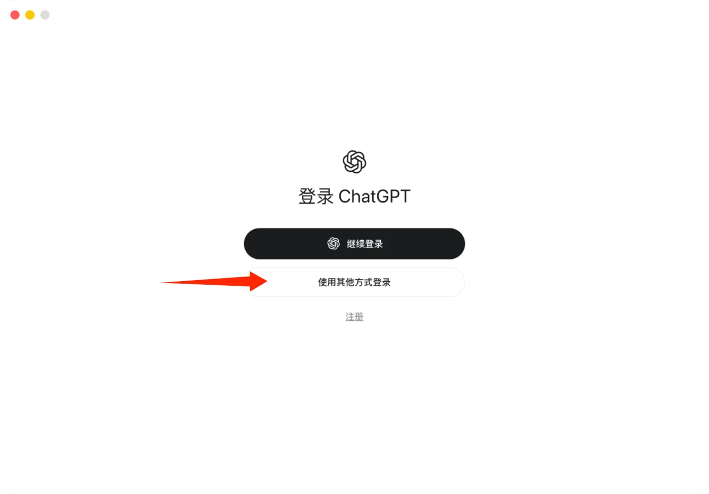
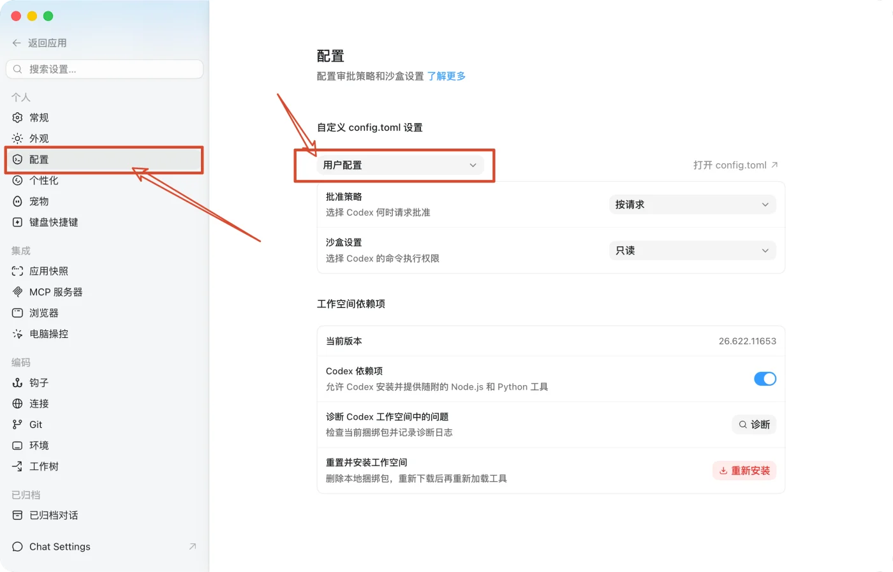
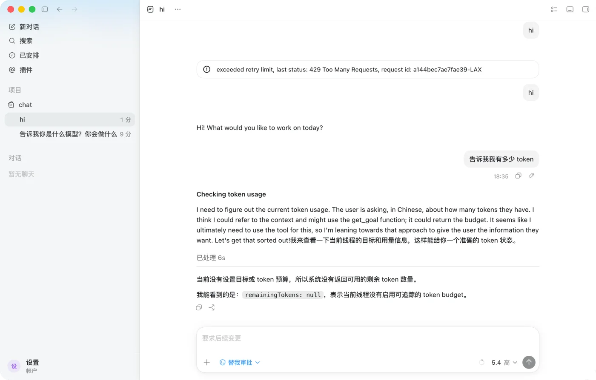
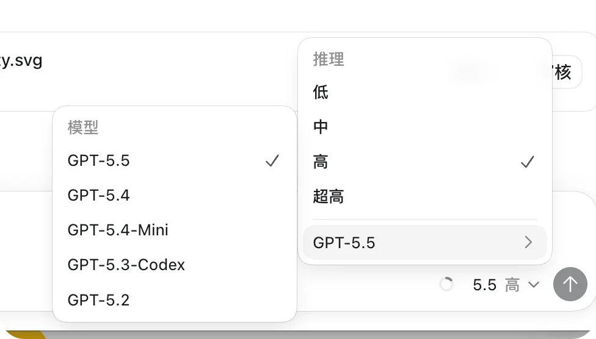
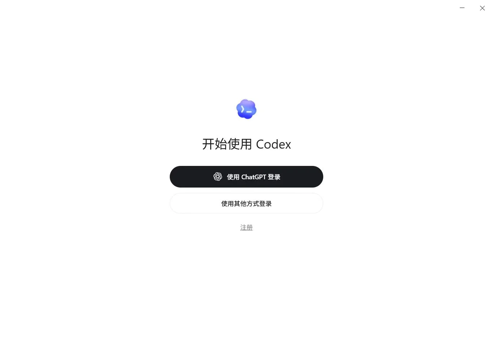
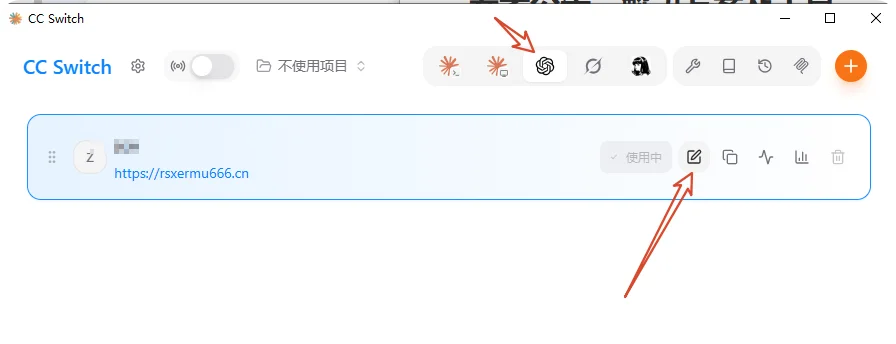
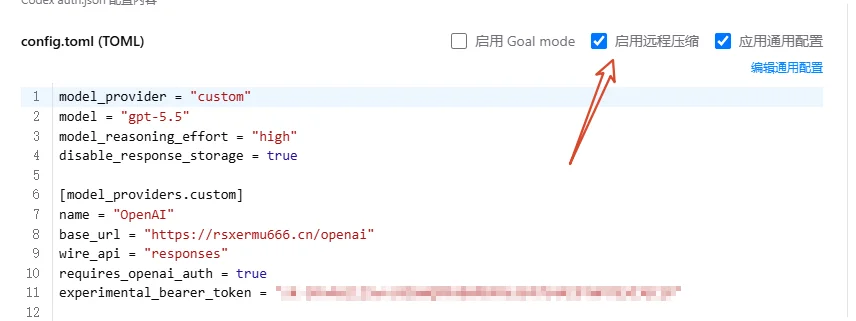

# Codex（不太推荐）

另一条产品线，和 Claude Code 分开计费。返回[总览](README.md)。

## 下载

<https://chatgpt.com/codex/>

访问后，可跳转至该页面。在页面中，直接点击页面中间的按钮即可。

## 中转站到 CC-Switch




### 点击编辑

点击编辑。




### 写入通用配置并保存

进入页面后，选择 写入通用配置并保存。





### 回到 Codex

回到 Codex，如下图所示：




看效果，可以用的模型，如下图所示：

## 几个注意事项

那 Hermes 能用吗？**不能**

由于 GPT-5.6 **不稳定**，所以现在先不上这个模型。

如果打开界面后是这个样子的，可以把 Codex 先关掉，然后去 CC Switch 配置，配置好以后再重新打开 Codex（switch 重新生成后，**重启 codex** 后它自动校验到 API 然后自动登录了）

上下文压缩：可开启 CC-Switch 的这个选项（图一点进来，往下拉就能看到了）：

价格见[套餐与价格](plan.md)的 GPT / Codex 部分。
