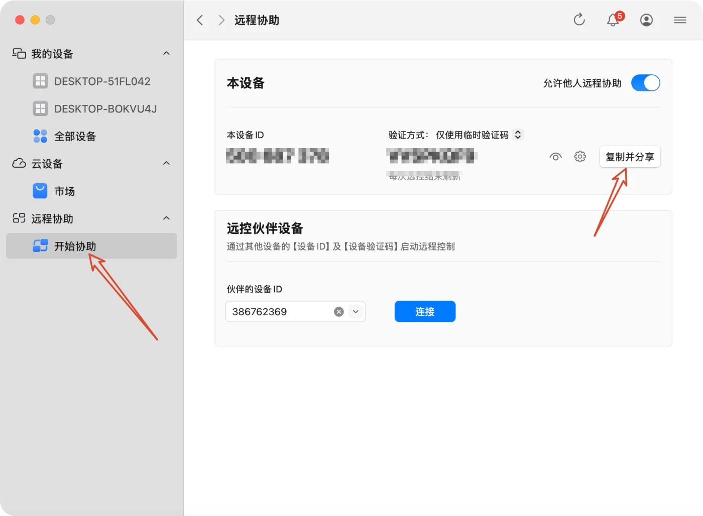

# 排障与联系

没有归到具体流程里的问题放这里；安装和价格的问题在各自主页。返回[总览](README.md)。

## 回答的效果好像不尽如人意？

算力不足的时候会降智，就比如 2026-6-23 的时候，官方算力不足，降智十分明显。

## Claude 回答突然中断怎么办？

[Claude回答突然中断怎么办？5种解决方法（2026最新）](https://my.feishu.cn/wiki/T23uweQZdiT2tFkaTy0chrljn5f)

Claude 回答中断90%的情况是 **token 上限**导致的，直接回复”继续”就能解决。其余情况按照本文的判断表对号入座处理即可。养成”长任务主动拆分”的习惯，比事后处理中断要高效得多。

## 远程协助

推荐 UU 远程，官网地址：<https://uuyc.163.com/>

点进来后，下载安装即可；下载安装登录完毕后，可点击软件中的 开始协助，并将自己的设备码和验证码复制并分享给好友即可。

## 联系一轩

如有疑问，可以加一轩微信。添加备注：中转站过来的

另外，欢迎关注一轩的微信公众号：浑语阁
