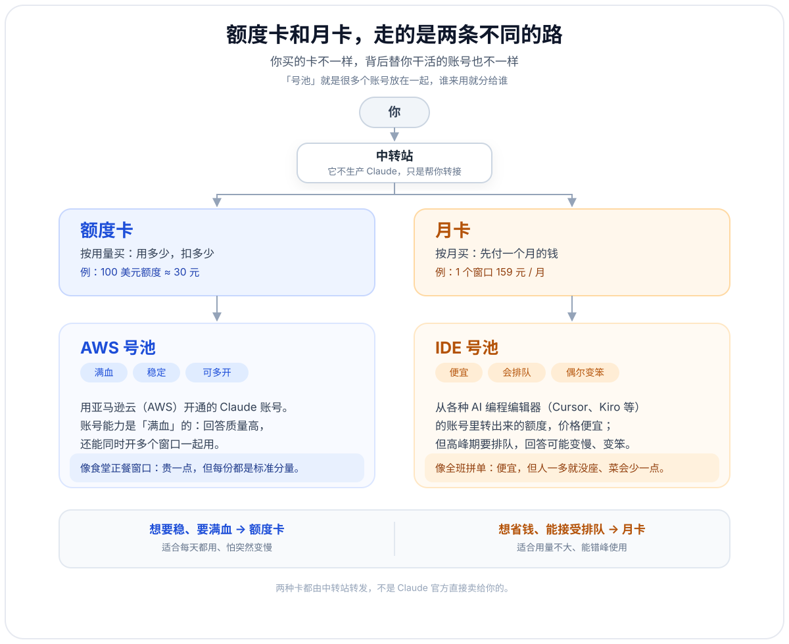
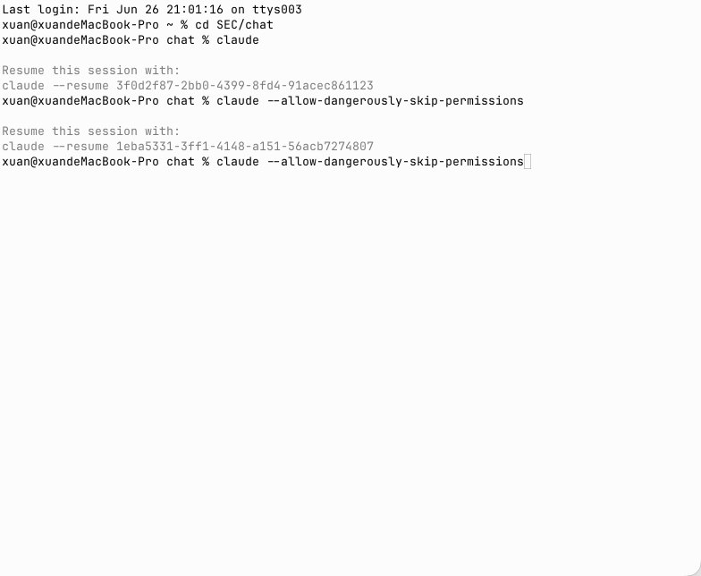
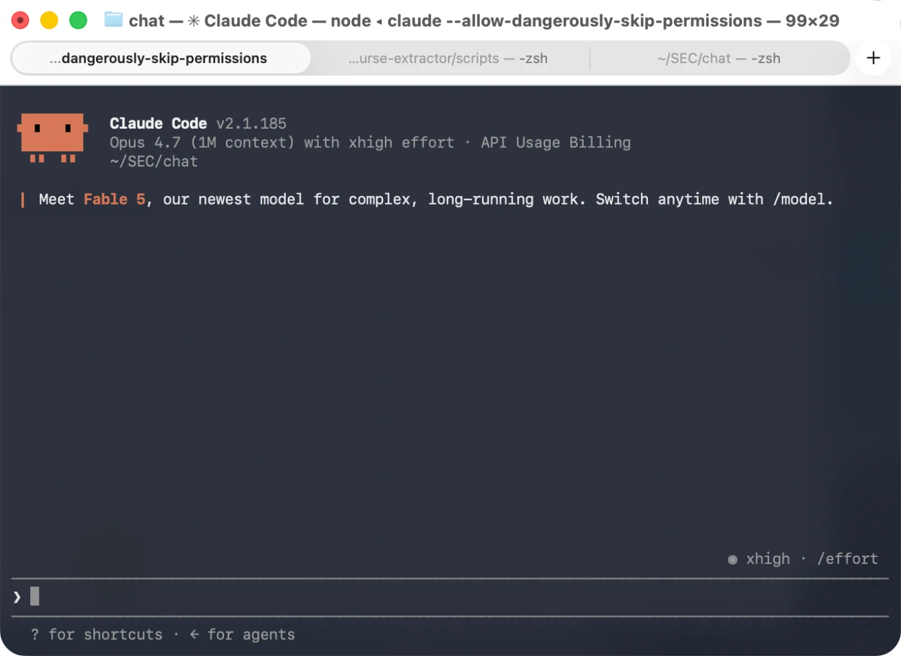

# 术语

最后更新：2026-11-14

<figure><figcaption>
两种卡背后是不同的号池
</figcaption></figure>

后面聊价格、套餐、续费，都会用到下面这几个词。这里一次定清楚，全文按这个口径。

- **号池**：很多个账号放在一起，谁来用就分给谁。中转站自己不生产 Claude，它只是把一堆账号集中起来，按卡的类型分给用户。
- **AWS 号池**：用亚马逊云（AWS）开通的 Claude 账号。账号能力「满血」——回答质量高，可以同时开多个窗口。额度卡走这条。
- **IDE 号池**：从各种 AI 编程编辑器（Cursor、Kiro、Windsurf 等）的账号里转出来的额度。价格便宜，但高峰期要排队，回答可能变慢、变笨。月卡走这条。
- **满血 / 非满血**：满血指账号能力完整；非满血指算力紧张时会被降智。这是卖家的说法，不是精确指标。
- **窗口**：同一时间最多能开几个 AI 一起干活。1 个窗口 = 同时用 1 个 AI。
- **额度卡**：按用量买，用完再买。
- **月卡**：按月买，按窗口数计价。也叫「不限量卡」。

具体价格数字统一放在[套餐与价格](plan.md)一节。

## 关于窗口

很多朋友问我：

「你说的是中转站窗口，那这里的窗口到底是什么？」

其实很简单：

1个窗口 = 1个正在工作的 AI 助手

你可以在 Mac、Windows、多台电脑上使用，不限制设备。

但同一时间只能保持对应数量的 AI 在工作。

例如：

- 1窗口 = 同时使用 1 个 AI
- 3窗口 = 同时使用 3 个 AI
- 5窗口 = 同时使用 5 个 AI...

（指 **并发数量**。若使用 1 窗口，如果后台 Agent 在跑，那么前面可能就不能使用了。此时建议双窗口及以上）

### 双窗口举例

这个中转站只有 2 个座位。如果一个人正在和 AI 持续聊天，他会一直占着 1 个座位。这时只剩下 1 个座位给其他 Agent 使用。

A 正在和 AI 聊天，占用 1 个并发。B Agent 开始工作，占用第 2 个并发。这时 C、D、E Agent 都来了，因为两个位置已经满了，它们只能排队。B 做完后，C 才能进去；C 做完后，D 再进去。

所以核心不是「只能两个人使用」，而是：任何一个时刻，最多只能有 2 个正在进行中的 AI 会话。一个长时间聊天占住其中一个后，剩下所有自动化 Agent 实际上只能共享另一个通道，表现出来就是一个接一个排队。

## CLI 是什么

CLI，是指命令行下面的 Claude code，即 Claude code CLI，通常长这个样子：

（图一使用 CMUX 打开：<https://cmux.com/download/confirmation>）

## 可用模型

- Opus 4.6 - 5
- Sonnet 4.6，5
- Haiku 4.5
- fable-5
- claude-fable-5-1
