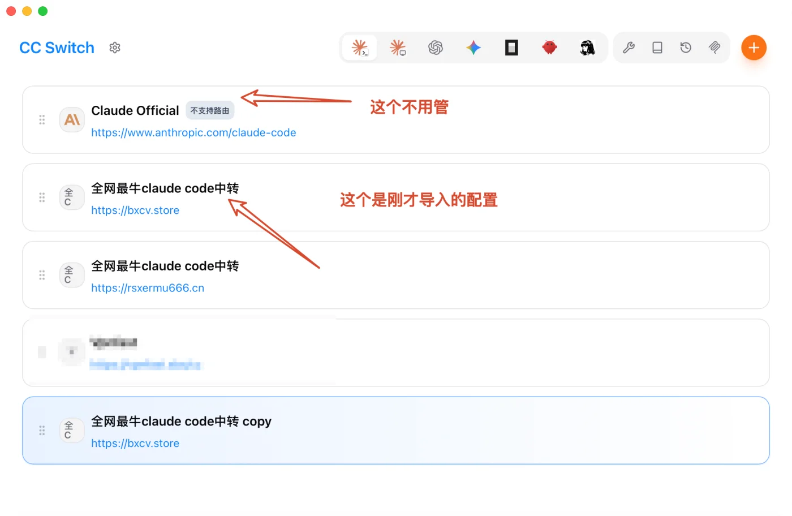
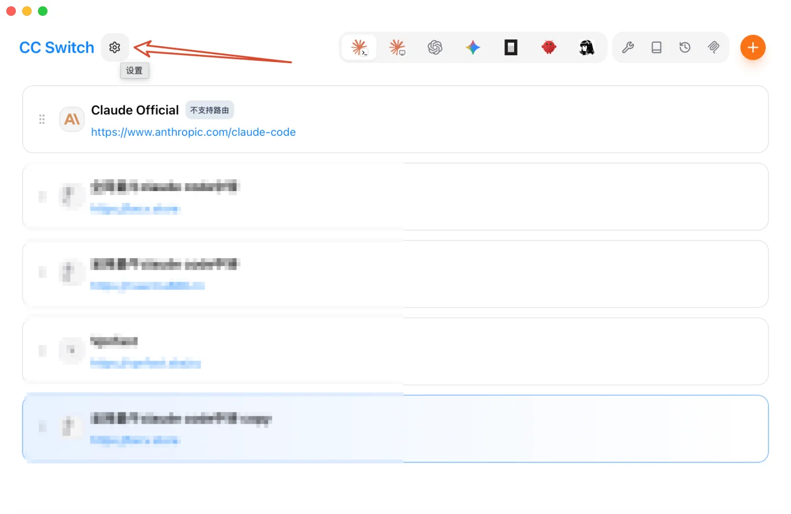
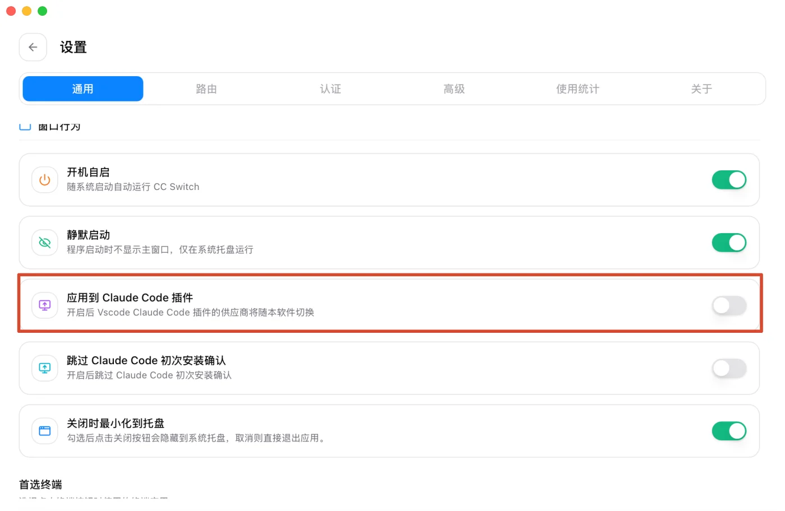
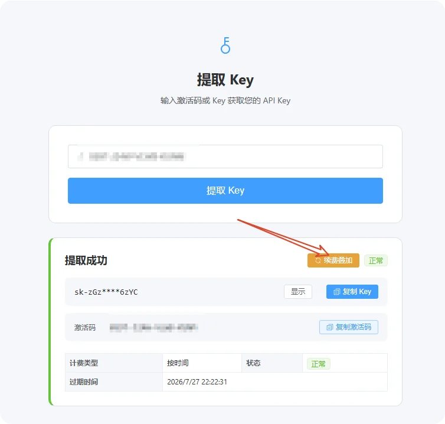
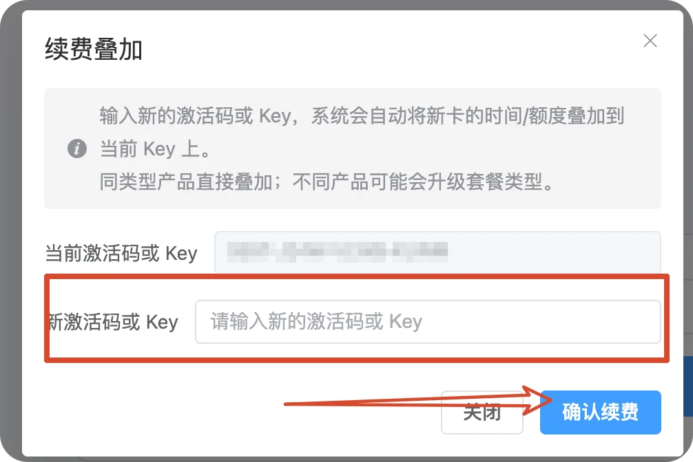

# 导入配置与续费


**所有链接都不用手机自带浏览器打开，都不用微信打开！！！**


把激活码导进 CC-Switch。前置：已装好 CC-Switch（见[安装](install.md)），手里有激活码。

<!-- 待补：激活码获取方式（下单后发 / 群里领 / 微信找一轩） -->

当前站点：<https://api.orbit1.lat/query>

（上面这一行是全文唯一需要改的站点地址，站点换的时候改这里。）

## Start

刚开始我会给这样一个链接，只要打开浏览器访问，就会看到这样的界面：

<figure><figcaption>
新的站点
</figcaption></figure>

在这个界面上，你需要输入我提供给你的激活码；之后点击 查询。查询成功后，页面会显示你的额度信息。

若显示提取成功，点击页面左侧的「使用教程」，进入使用教程页。

到这里以后，默认你已经安装了 CC Switch。此时只需要点击页面当中的「一键导入配置」，浏览器会提醒是否打开 CC Switch，点击 是。接下来配置项就会出现在 CC Switch 中。

此时我们点击启用，系统便会将全局的 Claude 配置设置为刚才导入的配置：

（等到后期自己十分熟悉以后，可以点击启用按钮右面的编辑，去里面编辑对应的配置选项。如果自己想尝试一下，可以点击右面的复制，先复制一份出来，去里面随便折腾）


一键导入之后，CC-Switch 里的配置教程仍然建议看一遍，尤其关于 MAC 的部分。


## 继续使用（续费）




### 提取旧 Key

首先，可以来到页面中图一的位置，提取 KEY 的部分，一定是旧的激活码。输入后，可以点击页面中的 续费叠加。




### 确认续费

将同类型的激活码输入弹出的窗口下方，并点击 确认续费 即可。



