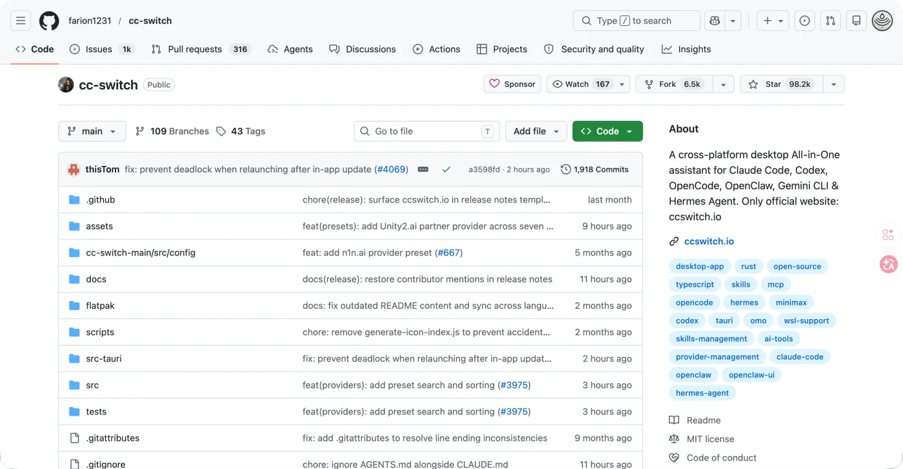
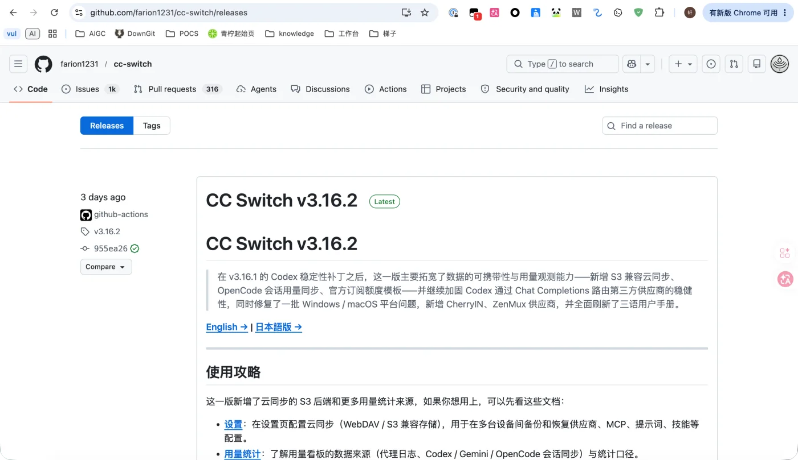
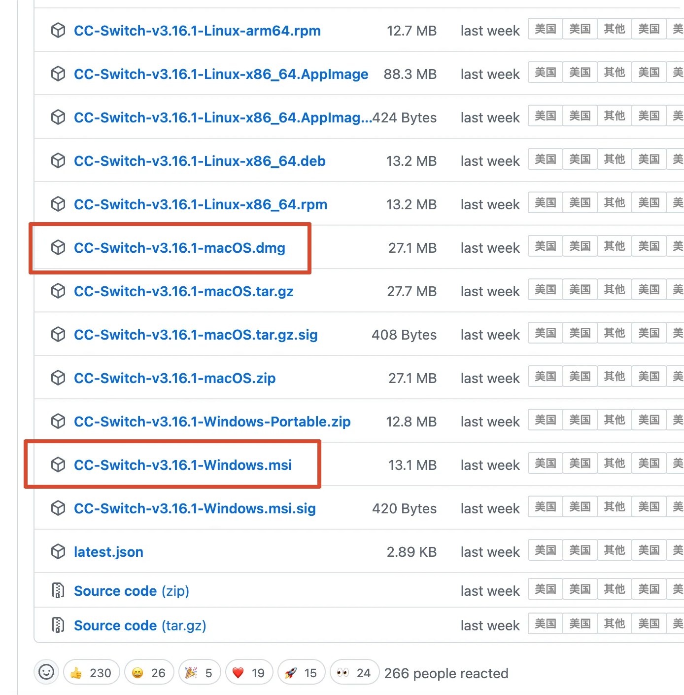
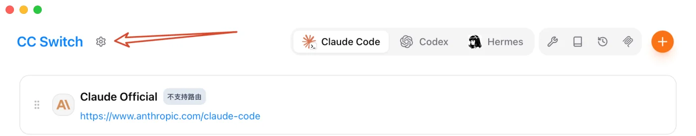
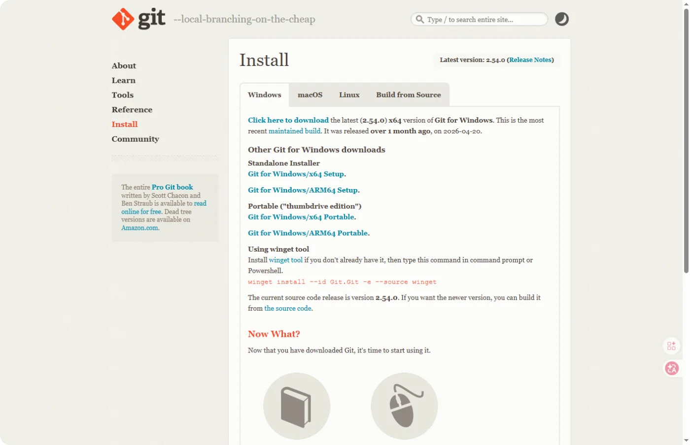
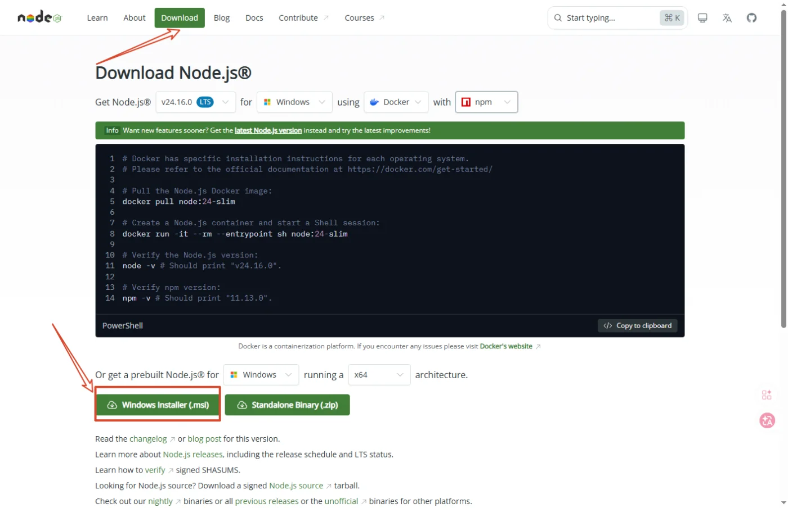
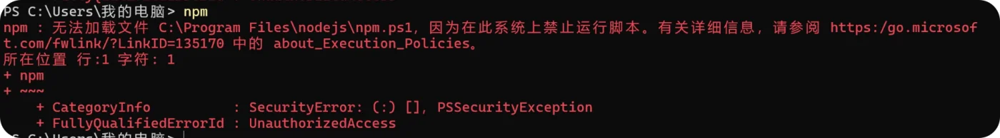
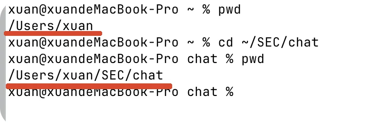
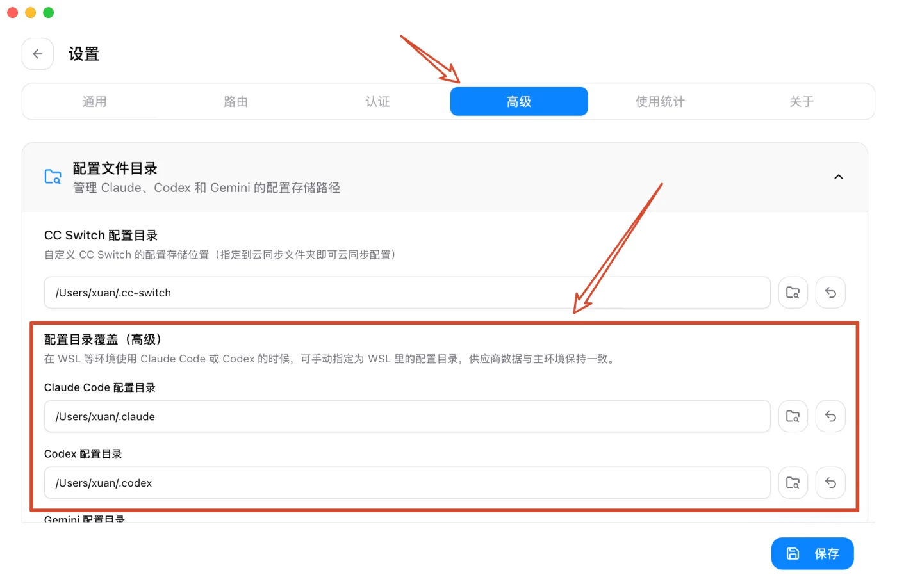

# 安装


**所有链接都不用手机自带浏览器打开，都不用微信打开！！！**


从零装到能在终端打出 `claude`。前置：一台能装软件的电脑。返回[总览](README.md)。

## CC-Switch 安装

用浏览器输入链接：

<https://github.com/farion1231/cc-switch/releases>





可以去这个页面中下载安装，选择对应的文件下载即可。

Windows 或者 MacOS 电脑，可以往下看：



Windows 系统，可选择 `.msi` 结尾的安装；

MAC M 系列芯片可选择 `.dmg` 结尾的。单击即可下载。

小建议：尽量让 CC Switch 保持最新版本。

如何更新？



## Claude Code 安装

```
# 更新的时候也可以用这个命令
npm install -g @anthropic-ai/claude-code
```

要做到执行上面的这个命令，首先需要做的就是下载 NodeJS。Mac 电脑或者 Windows 电脑可以自行去找相关的教程。

### MAC OS

安装 homebrew，node，git。

- Homebrew：<https://brew.sh/>
- NodeJS：<https://nodejs.org/en/download>

### WINDOWS

分别下载 Git，NodeJS。



<https://git-scm.com/install/windows>



<https://nodejs.org/en/download>

如果 NPM 命令运行的时候出现了报错，可以试试：



```
Set-ExecutionPolicy -Scope CurrentUser -ExecutionPolicy RemoteSigned
```

## 给 Claude Code 一个工作区

意思就是要选择一个 Claude Code 的工作区，（家里如果有孩子的，肯定会有一堆玩具。那么最终那些玩具要被收到客厅角落的玩具箱呢？还是收到卧室的玩具箱呢？）同理，可以在电脑里喜欢的位置下新建一个文件夹，用那个文件夹来存放自己与 Claude code 聊天时产生的众多文件。

我的位置在 `~/SEC/chat`

```
# 新建文件夹：MAC
mkdir ~/SEC/chat
# 进入文件夹
cd ~/SEC/chat
# 进入以后，再输入 claude ，点击回车，进入 claude code 界面
```



## WSL 用户的配置位置

CC-Switch 的高级设置中，可以选择 WSL 里 claude code 配置文件位置。



## PowerShell 中文乱码

[About Coding](https://my.feishu.cn/wiki/KBNbwhkbDiYYwlkCHvucgJLnnch)
