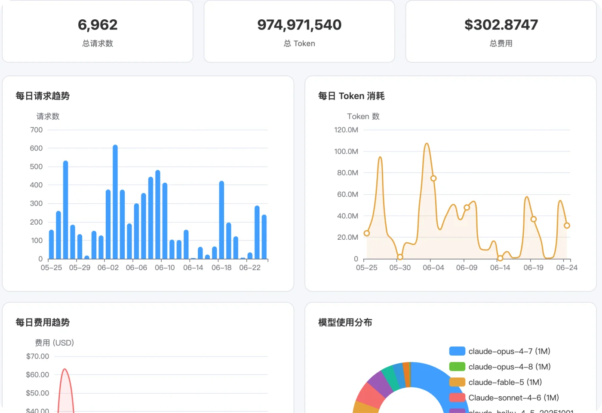
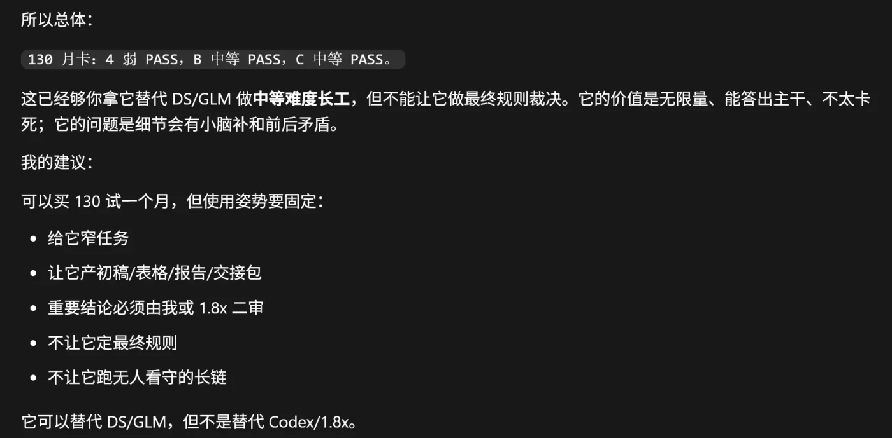

# 套餐与价格


最后更新：2026-11-14

## 这是一个什么样的中转站

最近用到一个很不错的中转站，用了快一个月。站点后台显示，这段时间的 token 总量是 9 亿。



那就涉及到一个 Claude Code 的安装，以及中转站配置的导入问题。

## 关于月卡，我想说的

或许，我们都高估了自己的硅基时间；

也许，我们并不需要什么所谓的不限量。

就像有的随身 WiFi 或者大流量卡宣称的，一个月 40 元流量不限量使用一样，其实仔细回想，我们能用了那么多吗？也许我们所谓的不限量，只是购买的一种自己内心的安全感。

以我的例子来说，近一个月的时间，我也只用了不到 350 刀的额度。而我每天的工作以及闲暇时间基本都是在电脑上度过的。我才用了这么一点，那你呢？

两个数字口径不同：9 亿是站点统计的 token 总量，350 刀是实际扣掉的额度，不是一回事。

- 真的需要所谓的不限量吗？
- 敢先很极端地去试一下自己究竟能用多少吗？

也许每个月按量付费，才是更适合自己的。还怕不够用的话，每个月先给自己来 500 刀试试呢？

## 额度卡与月卡

Claude Code 走哪种号池，看买的是哪张卡：

- **额度卡**：走 AWS 号池（满血）—— 支持 opus 5；**支持多窗口**
- **月卡**：走 IDE 号池（非满血）—— 支持全部模型。额度来自 Cursor、Kiro、Windsurf、Copilot、Antigravity（反重力）等编辑器账号

## 价格（CNY）

| 卡种  | 计价方式  | 价格        |
| --- | ----- | --------- |
| 额度卡 | 100 刀 | 30 CNY    |
| 月卡  | 1 个窗口 | 159 CNY   |
| 月卡  | 2 个窗口 | 179 CNY   |
| 月卡  | 3 个窗口 | 219 CNY   |
| 天卡  | 1 天   | 18 CNY    |

额度卡用完即止，也没有其他人所谓的什么 5 小时限制。

## GPT / Codex 的额度与月卡

有老板实测，20 美元（130+）的 Plus 一个月用下来相当于 **350 刀**额度；月卡是额度每天 100，相当于月 3000 刀。经常用的话，性价比是可以有的。

上下文长度随官方的，没限制。

| 卡种     | 计价方式         | 价格        |
| ------ | ------------ | --------- |
| GPT 额度 | 100 刀        | 30 CNY    |
| GPT 月卡 | 每天 100 刀额度   | 150 CNY/月 |

## Some Plus or Pro（官方订阅代充）

[GPT 代充教程](../untitled/gptdc.md)

| 产品         | 详情      | 价格（CNY） |
| ---------- | ------- | ------- |
| GPT        | Plus    | 158     |
|            | Pro 5x  | 740     |
|            | Pro 20x | 1380    |
| Claude     | Pro     | 168     |
|            | Max     | 待补充     |
| Grok       |         | 待补充     |
| X（Twitter） |         | 待补充     |
| Cursor     | 20 刀    | 165     |

标「待补充」的是暂时没有报价，需要时直接问一轩。

## 支持快速模式吗

不支持。

## 群友实测（未经独立核实）

使用群友的测试结果：

```
# 额度卡

这家公司 token 满血线现在可以判：
TOKEN_FULL_BLOOD_PLAUSIBLE
也就是说：扣 token 的“满血”能力看起来是真的，至少不低于主力候选线。
和 1.8x 比：
1.8x：更像稳定主力，边界纪律已经测过“继续”不乱跑
小公司 token 版：能力也强，B/C 都过，但还没测长任务边界和高峰期稳定
下一步如果你考虑 130 月卡，别再测“会不会答题”，而是测：
同样题 C 是否明显降智
长一点交接包是否守边界
重复 2-3 次是否稳定
高峰期是否从这个水平掉到 0.65x 那种泛泛答案
如果 130 只是慢、限速，但答案保持这个水平，那就有价值。

# 不限量卡
```


