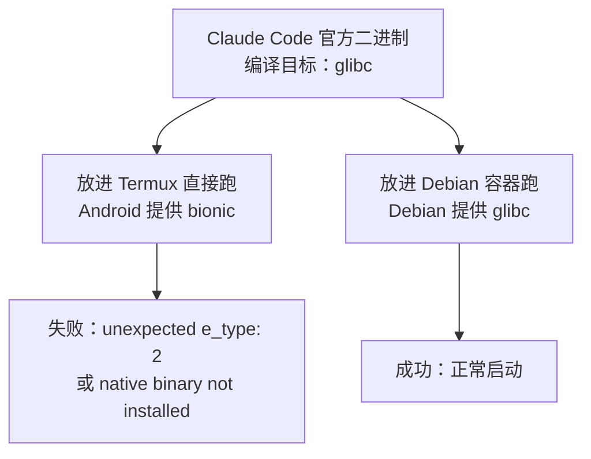
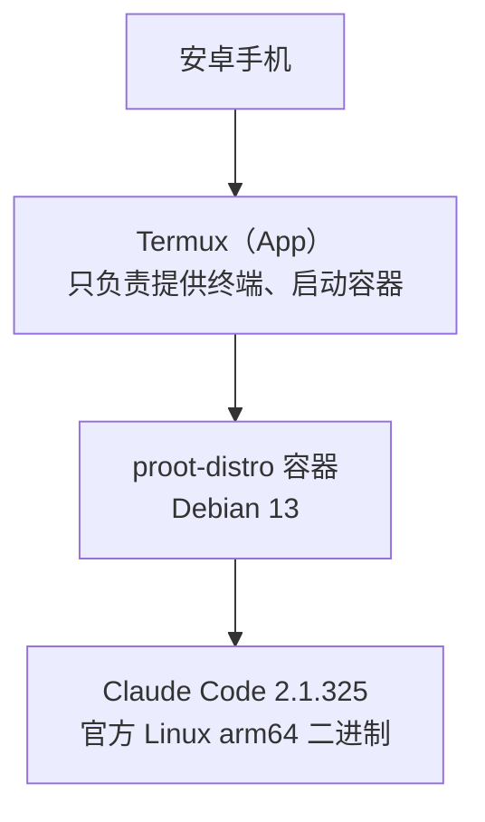
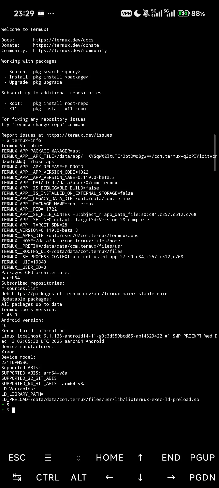
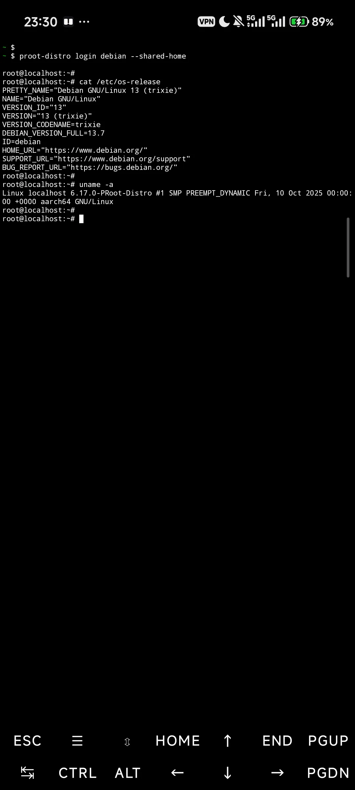
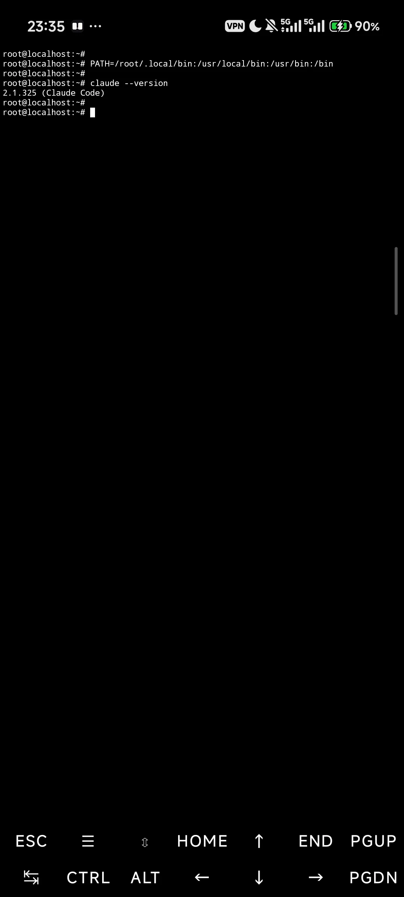
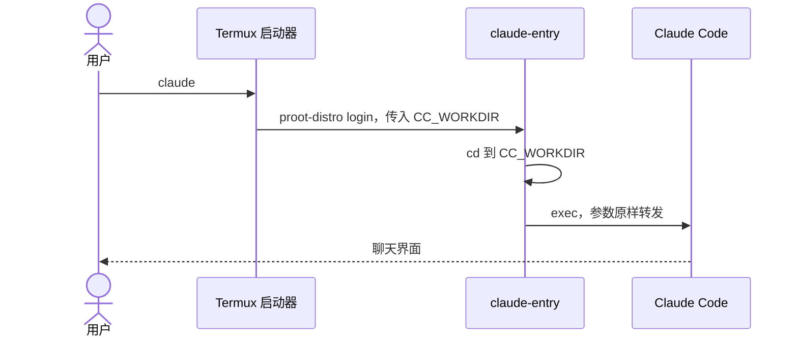
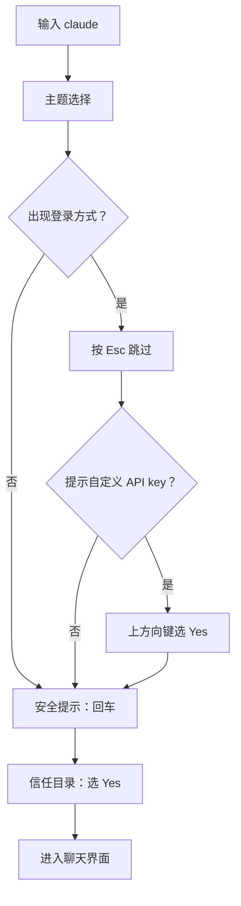
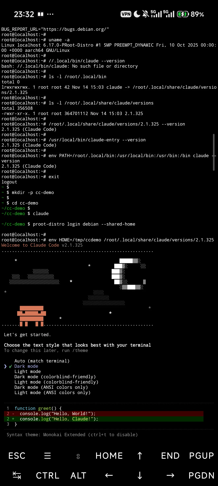
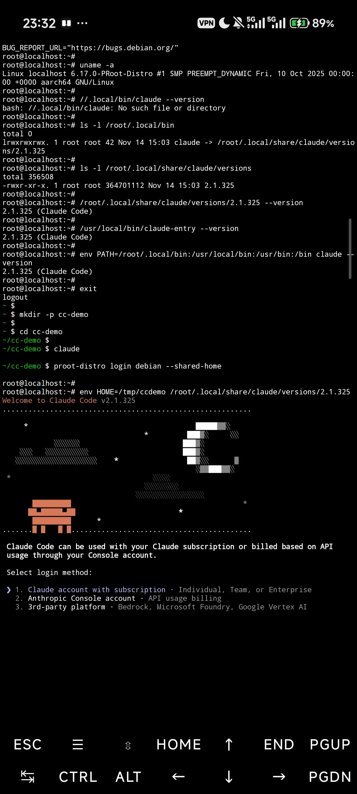
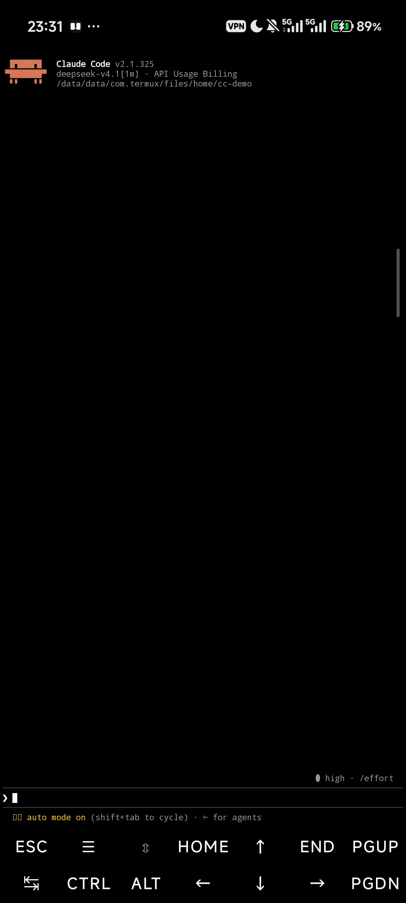

# 在安卓手机上运行 Claude Code：零基础完整教程

> 实测设备：Redmi K60 Pro（23116PN5BC）· HyperOS 3 · Android 16 · arm64
> 实测日期：2026-11-14
> 实测版本：Termux 0.119.0-beta.3（F-Droid，versionCode 1022）· proot-distro 5.10.3 · Debian 13（trixie）· Claude Code 2.1.325
> 最终效果：打开 Termux，输入 `claude`，进入 Claude Code 聊天界面；费用走中转 API 的 key，不走订阅登录。

---

## 0. 极简版：已经会 Linux 的人看这里

```sh
# Termux（必须是 F-Droid / GitHub 官方版，不能用应用商店版）
pkg update && pkg upgrade -y
termux-setup-storage
pkg install -y proot-distro
proot-distro install debian:13
proot-distro login debian --shared-home

# Debian 容器内
apt update && apt install -y curl ca-certificates git ripgrep
curl -fsSL https://claude.ai/install.sh | bash
exit

# Termux：写配置（把 <YOUR_API_KEY> 换成自己的 key）
mkdir -p ~/.claude
cat > ~/.claude/settings.json <<'EOF'
{
  "env": {
    "ANTHROPIC_BASE_URL": "https://<YOUR_API_URL>",
    "ANTHROPIC_API_KEY": "<YOUR_API_KEY>",
    "ANTHROPIC_DEFAULT_OPUS_MODEL": "deepseek-v4.1",
    "ANTHROPIC_DEFAULT_SONNET_MODEL": "deepseek-v4.1",
    "ANTHROPIC_DEFAULT_FABLE_MODEL": "deepseek-v4.1",
    "ANTHROPIC_DEFAULT_HAIKU_MODEL": "deepseek-v4.1",
    "CLAUDE_CODE_MAX_CONTEXT_TOKENS": "460000",
    "CLAUDE_CODE_AUTO_COMPACT_WINDOW": "454000",
    "ENABLE_TOOL_SEARCH": "true",
    "CLAUDE_CODE_DISABLE_NONESSENTIAL_TRAFFIC": "1",
    "CLAUDE_CODE_DISABLE_MOUSE": "1"
  }
}
EOF
chmod 600 ~/.claude/settings.json

# Termux：做 claude 启动器
cat > $PREFIX/bin/claude <<'EOF'
#!/data/data/com.termux/files/usr/bin/bash
exec proot-distro login debian --shared-home -e "CC_WORKDIR=$PWD" -- /usr/local/bin/claude-entry "$@"
EOF
chmod 755 $PREFIX/bin/claude

proot-distro login debian -- bash -c 'cat > /usr/local/bin/claude-entry && chmod 755 /usr/local/bin/claude-entry' <<'EOF'
#!/bin/bash
if [ -n "$CC_WORKDIR" ] && [ -d "$CC_WORKDIR" ]; then cd "$CC_WORKDIR"; fi
export PATH="$HOME/.local/bin:$PATH"
exec "$HOME/.local/bin/claude" "$@"
EOF
```

然后在任意目录运行 `claude`。

下面是从零开始的完整解释。第一次接触 Linux 也没关系，按顺序做即可。

---

## 1. 先弄懂：为什么不能直接在 Termux 里装

### 1.1 四个名词

| 名词 | 用人话解释 |
|---|---|
| **Termux** | 一个安卓 App。打开后是一个黑色终端窗口，能在手机里运行 Linux 风格的工具。 |
| **Android / bionic** | 安卓系统用的是自己的一套 C 运行库，叫 bionic。 |
| **Linux / glibc** | 普通电脑上的 Linux 用的是另一套运行库，叫 glibc。 |
| **proot-distro** | Termux 里的工具。它能在 Termux 内部再装一个完整的 Debian Linux，不需要 root。可以理解为“房间里再隔一个小房间”。 |

### 1.2 问题的根源

Claude Code 从 **v2.1.113** 开始，官方只提供“原生二进制”。这个二进制是给 **glibc** 的 Linux 编译的。

安卓是 **bionic**，不是 glibc。所以直接在 Termux 里运行会失败，典型报错：

```text
error: "bin/claude.exe" has unexpected e_type: 2
```

或者：

```text
Error: claude native binary not installed.
```

官方 issue 已确认这一点（anthropics/claude-code #50270，截至 2026-10 仍开放）。issue 讨论里也确认：**proot-distro 里的 Debian 可以正常运行**，因为容器里是标准 Linux 环境。

同一份二进制，放进两个不同的运行库环境，结果相反：



所以这套方案不是绕路，是补上唯一缺的那一层。

### 1.3 结构图



Termux 本身只负责“提供终端”和“启动容器”。真正干活的 Claude Code 在 Debian 容器里。

---

## 2. 准备清单

| 项目 | 要求 | 说明 |
|---|---|---|
| 手机 | Android 7 以上，arm64 | 本教程用 Android 16 实测。 |
| 存储空间 | 至少 2 GB 空闲 | Debian 容器 + Claude Code 约 1 GB。 |
| 网络 | 安装阶段能访问 GitHub / Docker Hub / claude.ai | 国内网络可能需要代理；后文给了镜像替代方案。运行时只需要能访问你自己的 API 中转地址。 |
| 电脑 | **不必须** | 全程可以在手机上完成。附录 A 是电脑辅助路线。 |
| root | **不必须** | 主路线不需要 root。 |
| 时间 | 30–60 分钟 | 取决于网速。 |

---

## 3. 安装官方 Termux（第一个大坑）

### 3.1 不要用应用商店版

应用商店（Google Play）的 Termux 是 `googleplay` 版本。实测发现两个硬伤：

1. 它的软件源指向 `https://termux.net`，这个域名已经下线（返回 404）。
2. 它的签名和官方仓库不匹配。手动换官方源会报：

```text
The following signatures couldn't be verified because the public key is not available:
NO_PUBKEY 5A897D96E57CF20C
```

换句话说：应用商店版**装不了任何新软件包**，正好把教程卡死在第一步。

### 3.2 正确来源

二选一：

- **F-Droid**：<https://f-droid.org/packages/com.termux/>
- **GitHub Releases**：<https://github.com/termux/termux-app/releases>

F-Droid 上最新的 Termux 是 **0.119.0-beta.3**（versionCode 1022，截至 2026-11）。GitHub Releases 可能更新较慢。版本号以后会变，如果下面的直链失效，去 F-Droid 页面找当前版本。

**注意签名**：F-Droid 版和 GitHub 版使用不同的签名，二者不能互相覆盖安装。切换来源必须先卸载。

国内下载慢时，可以用清华镜像的 F-Droid 仓库：

```text
https://mirrors.tuna.tsinghua.edu.cn/fdroid/repo/com.termux_1022.apk
```

下载后建议核对 SHA-256。F-Droid 索引里 1022 版本的值是：

```text
fdd476982cd74f2f00aac12d3683b1fa260a0b2d146411b94e09d773be3a7b56
```

核对方法（手机装个文件管理器看哈希，或在电脑上运行 `shasum -a 256 文件名`）。对不上就不要安装。

### 3.3 如果手机里已经有应用商店版

先备份再卸载。Termux 的数据目录需要 root 才能直接备份；没有 root 就确认里面没有重要文件（新装的通常是空的）。

```sh
# 有 root 时，在 Termux 或 adb shell 里执行
su -c 'tar -cf - -C /data/data/com.termux/files home | gzip > /sdcard/termux-home-backup.tar.gz'
```

然后正常卸载旧 Termux，安装新 APK。安装后第一次打开，Termux 会自动解压基础系统，等它出现 `~ $` 提示符即可。

### 3.4 验证

在 Termux 里输入：

```sh
termux-info
```

看到 `Packages CPU architecture: aarch64`、`Android version: 16` 这类信息就对了。如果还显示 `googleplay` 或软件源是 `termux.net`，说明装错了。



---

## 4. Termux 初始化

### 4.1 更新软件包

```sh
pkg update
pkg upgrade -y
```

第一次会下载几十 MB。

**如果卡住或很慢**：运行 `termux-change-repo`，在界面里选择清华 TUNA 镜像（方向键移动，空格选择，回车确认）。镜像地址是：

```text
https://mirrors.tuna.tsinghua.edu.cn/termux/apt/termux-main
```

换完再执行一次 `pkg update`。

### 4.2 打开存储权限

```sh
termux-setup-storage
```

手机会弹出权限框，点“允许”。成功后家目录里会出现 `storage` 文件夹，里面 `shared` 指向手机的内部存储（相册、下载等）。

### 4.3 安装 proot-distro

```sh
pkg install -y proot-distro
proot-distro --version
```

实测版本是 5.10.3。注意：**5.x 版本改为从 Docker Hub 拉取 Linux 镜像**，不再从 GitHub 下载 rootfs。这影响下一步。

---

## 5. 安装 Debian 13 容器

### 5.1 拉取镜像

```sh
proot-distro install debian:13
```

正常输出会看到：

```text
[*] Fetching aarch64 manifest...
[*] Downloading layer 1/1 (47.5 MiB)...
[*] Finished installation.
```

**踩坑：Docker Hub 在国内经常连不上。** 两个办法：

1. 手机开代理（本次实测走的就是代理）。
2. 用国内 Docker 镜像站，把镜像地址写成完整引用：

```sh
proot-distro install docker.m.daocloud.io/library/debian:13
```

或者：

```sh
proot-distro install docker.1ms.run/library/debian:13
```

这条镜像路线我们只验证了镜像站可达（返回 401 属于正常的匿名未授权响应），**没有在干净手机上完整跑通**，属于备选方案。安装失败的报错通常会明确写出连不上的域名。

### 5.2 进入容器

```sh
proot-distro login debian --shared-home
```

参数说明：

- `--shared-home`：把 Termux 的家目录挂到容器里的 `/root`。这样配置、项目文件在两边都能看到。**不加这个参数，后面写的配置 Claude Code 读不到。**
- 默认以 root 身份进入容器。这里的 root 是“容器里的 root”，不是手机的真 root。

进去后提示符会变成类似 `root@localhost:~#`。验证：

```sh
cat /etc/os-release
uname -a
```

应看到 `Debian GNU/Linux 13 (trixie)` 和 `Linux ... 6.17.0-PRoot-Distro`。



### 5.3 装基础工具

```sh
apt update
apt install -y --no-install-recommends curl ca-certificates git ripgrep less nano
```

**如果 Debian 源慢**，换成清华镜像（Debian 13 的源配置文件是 deb822 格式）：

```sh
sed -i 's|http://deb.debian.org/debian|https://mirrors.tuna.tsinghua.edu.cn/debian|' /etc/apt/sources.list.d/debian.sources
apt update
```

原来的 `deb.debian.org/debian-security` 会被一并替换成清华的 `debian-security`，不需要单独处理。

验证：再跑一次 `apt update`，没有报错、能看到 `Reading package lists...` 即可。

---

## 6. 安装 Claude Code

### 6.1 官方安装脚本

在容器里执行：

```sh
curl -fsSL https://claude.ai/install.sh | bash
```

成功输出：

```text
✔ Claude Code successfully installed!
  Version: 2.1.325
  Location: ~/.local/bin/claude
```

**踩坑：`claude.ai` 在中国大陆会重定向到 “App unavailable in region”。** 这一步必须能访问 claude.ai，也就是需要代理。判断方法：

```sh
curl -fsSL https://claude.ai/install.sh | head -3
```

正常应看到 `#!/bin/bash`；如果返回 HTML（`<!DOCTYPE html>`），就是被区域拦截了。

没有代理时的三个备选（按可行性排序）：

1. **开代理完成安装**。装完之后日常使用不需要一直开着代理，因为 API 走的是中转地址。
2. **npm 安装**（未实测，属于备选）：
   ```sh
   apt install -y nodejs npm
   # Claude Code 要求 Node >= 22，Debian 自带版本可能不够
   npm config set registry https://registry.npmmirror.com
   npm install -g @anthropic-ai/claude-code --include=optional
   ```
   注意：npm 包现在也是下载平台原生二进制，必须带 `--include=optional`；Node 版本不够时需要装 Node 22。
3. **让能访问 claude.ai 的电脑代下 Linux arm64 版本，再传到手机**。适合有电脑的人。

### 6.2 验证

```sh
export PATH="$HOME/.local/bin:$PATH"
claude --version
```

看到 `2.1.325 (Claude Code)` 即成功。



`~/.local/bin` 不在默认 PATH 里，**先别退出容器**；后面做的启动器会处理 PATH。

---

## 7. 配置 API 地址和 KEY

### 7.1 为什么需要这一步

Claude Code 默认让你登录 Claude 账号（订阅）或用官方 API。这里改用**中转 API**：把请求地址和 key 写进配置文件，Claude Code 就会直接把请求发到中转站。

### 7.2 写配置文件

退出容器（`exit`），回到 Termux。执行（把 `<YOUR_API_KEY>` 换成真实 key）：

```sh
mkdir -p ~/.claude
cat > ~/.claude/settings.json <<'EOF'
{
  "env": {
    "ANTHROPIC_BASE_URL": "https://<YOUR_API_URL>",
    "ANTHROPIC_API_KEY": "<YOUR_API_KEY>",
    "ANTHROPIC_DEFAULT_OPUS_MODEL": "deepseek-v4.1",
    "ANTHROPIC_DEFAULT_OPUS_MODEL_NAME": "deepseek-v4.1",
    "ANTHROPIC_DEFAULT_SONNET_MODEL": "deepseek-v4.1",
    "ANTHROPIC_DEFAULT_SONNET_MODEL_NAME": "deepseek-v4.1",
    "ANTHROPIC_DEFAULT_FABLE_MODEL": "deepseek-v4.1",
    "ANTHROPIC_DEFAULT_FABLE_MODEL_NAME": "deepseek-v4.1",
    "ANTHROPIC_DEFAULT_HAIKU_MODEL": "deepseek-v4.1",
    "ANTHROPIC_DEFAULT_HAIKU_MODEL_NAME": "deepseek-v4.1",
    "CLAUDE_CODE_MAX_CONTEXT_TOKENS": "460000",
    "CLAUDE_CODE_AUTO_COMPACT_WINDOW": "454000",
    "ENABLE_TOOL_SEARCH": "true",
    "CLAUDE_CODE_DISABLE_NONESSENTIAL_TRAFFIC": "1",
    "CLAUDE_CODE_DISABLE_MOUSE": "1"
  }
}
EOF
chmod 600 ~/.claude/settings.json
```

### 7.3 每个字段在干什么

| 字段 | 作用 |
|---|---|
| `ANTHROPIC_BASE_URL` | 中转站地址。**不要带 `/v1`**，Claude Code 会自己拼 `/v1/messages`。 |
| `ANTHROPIC_API_KEY` | 中转站的 key。用这个变量，不要用 `ANTHROPIC_AUTH_TOKEN`（原因见 11.4）。 |
| `*_DEFAULT_*_MODEL` | 把 Claude Code 的模型档位映射到中转站真实模型名。本次中转只有 `deepseek-v4.1`。 |
| `*_MODEL_NAME` | 界面上显示的名字，不影响请求。 |
| `CLAUDE_CODE_MAX_CONTEXT_TOKENS` | 上下文窗口大小，按中转站模型能力写。 |
| `CLAUDE_CODE_AUTO_COMPACT_WINDOW` | 接近上限时自动压缩对话的阈值。 |
| `CLAUDE_CODE_DISABLE_MOUSE` | 关掉鼠标捕获，否则手机软键盘点不出来（见 11.5）。 |
| `CLAUDE_CODE_DISABLE_NONESSENTIAL_TRAFFIC` | 关掉非必要的遥测/更新检查，减少无谓请求。 |

### 7.4 先手动验证 key

在 Termux 里可以直接测试（key 用你的真实值）：

```sh
KEY='<YOUR_API_KEY>'
curl -sS -w "\nhttp=%{http_code}\n" https://<YOUR_API_URL>/v1/messages \
  -H "content-type: application/json" \
  -H "anthropic-version: 2023-06-01" \
  -H "x-api-key: $KEY" \
  -d '{"model":"deepseek-v4.1","max_tokens":8,"messages":[{"role":"user","content":"hi"}]}'
```

- `http=200`：key 和地址都对。
- `http=401` / `403`：key 错误或没权限。
- `http=404` 且提示 `model_unavailable`：模型名写错了。错误信息里会列出该中转实际可用的模型，照抄即可。

### 7.5 地址到底要不要加 `/v1`？

实测结论：**不要加。**

| 请求地址 | 结果 |
|---|---|
| `https://<YOUR_API_URL>/v1/messages` | 200 |
| `https://<YOUR_API_URL>/v1/v1/messages` | 404 |

Claude Code 的 debug 日志也显示它实际请求的是：

```text
POST https://<YOUR_API_URL>/v1/messages?beta=true
```

Claude Code 自己会拼接 `/v1/messages`，所以 `ANTHROPIC_BASE_URL` 只写到域名。

有些 cc-switch 类工具的 provider 配置里写的是 `https://<YOUR_API_URL>/v1`，那是给它们自己的代理层用的，直接抄给 Claude Code 会变成 `/v1/v1`。

---

## 8. 做一个顺手的 `claude` 命令

### 8.1 为什么需要启动器

直接在 Termux 里敲 `claude` 是找不到的：程序装在 Debian 容器里。每次手动执行 `proot-distro login debian --shared-home` 再运行，太麻烦。

做一个包装脚本，让 Termux 里的 `claude` 自动完成：

1. 进入 Debian 容器；
2. 保持当前目录；
3. 启动 Claude Code；
4. 参数原样传进去（`claude -c`、`claude -p "..."` 都能用）。

整条链路是这样走的：



出问题时按这条链逐段排查：`command -v claude` 查第一段，`proot-distro login` 查第二段，`claude --version` 查最后一段。

### 8.2 创建 Termux 侧启动器

在 Termux 里执行：

```sh
cat > $PREFIX/bin/claude <<'EOF'
#!/data/data/com.termux/files/usr/bin/bash
# 自动进入 Debian 容器并在当前目录启动 Claude Code
exec proot-distro login debian --shared-home -e "CC_WORKDIR=$PWD" -- /usr/local/bin/claude-entry "$@"
EOF
chmod 755 $PREFIX/bin/claude
```

### 8.3 创建容器侧入口脚本

```sh
proot-distro login debian -- bash -c 'cat > /usr/local/bin/claude-entry && chmod 755 /usr/local/bin/claude-entry' <<'EOF'
#!/bin/bash
# 从 Termux 进入时，切到调用者所在目录
if [ -n "$CC_WORKDIR" ] && [ -d "$CC_WORKDIR" ]; then cd "$CC_WORKDIR"; fi
export PATH="$HOME/.local/bin:$PATH"
exec "$HOME/.local/bin/claude" "$@"
EOF
```

### 8.4 验证

```sh
command -v claude        # 应输出 /data/data/com.termux/files/usr/bin/claude
claude --version         # 应输出 2.1.325 (Claude Code)
```

再测一次真实 API（不进入聊天界面）：

```sh
claude -p 'Reply with exactly: OK' < /dev/null
```

看到 `OK` 就说明整条链路通了：Termux → proot → Debian → Claude Code → 中转 API。

---

## 9. 第一次启动：屏幕上会出现什么

在 Termux 里，任意目录输入：

```sh
claude
```

按顺序可能会遇到这些界面。不同版本略有差异，按下面选择即可。



这里的每个叉路都跟配置状态有关，不是每次都出现。

### 9.1 主题选择

```text
Choose the text style that looks best with your terminal
```

方向键选 `Dark mode` 或 `Auto`，回车确认。



### 9.2 登录方式（可能跳过）

如果出现：

```text
Select login method:
  1. Claude account with subscription
  2. Anthropic Console account
  3. 3rd-party platform
```



因为已经在 `settings.json` 里配置了 key，这里直接按 `Esc`，选择“不登录继续”。如果后续出现：

```text
Detected a custom API key in your environment
Do you want to use this API key?
  Yes
> No (recommended)
```

用上方向键选 **Yes**，回车。这是 Claude Code 的安全机制：确认这个 key 是使用者自己设置的，而不是被别的程序偷偷注入。

### 9.3 安全提示

```text
Security notes:
1. Claude can make mistakes...
2. Due to prompt injection risks...
Press Enter to continue...
```

回车继续。

### 9.4 信任目录

```text
Accessing workspace: /data/data/com.termux/files/home
Quick safety check: Is this a project you created or one you trust?
> No, exit
  Yes, I trust this folder
```

方向键选 **Yes, I trust this folder**，回车。只对自己确认过的目录选 Yes。

### 9.5 进入聊天界面

顶部应显示：

```text
Claude Code v2.1.325
deepseek-v4.1[1m] · API Usage Billing
/data/data/com.termux/files/home
```

底部状态栏显示 `auto mode on`（本机版本还带 `· ← for agents`，右下角有 `high · /effort`），没有红色的 `Not logged in`。

发一句 `Say OK`，收到 `OK`，配置完成。



> 说明：顶部模型名显示成 `deepseek-v4.1[1m]` 是 Claude Code 的显示格式，实际请求体里是 `deepseek-v4.1`，已用 debug 日志核对。

---

## 10. 日常使用

### 10.1 基本用法

```sh
cd ~/my-project
claude
```

Claude Code 会在你当前所在目录启动。Termux 家目录、`~/storage/shared`（手机内部存储）里的目录都可以。

常用命令：

| 命令 | 作用 |
|---|---|
| `claude` | 打开交互界面 |
| `claude -c` | 继续上一次对话 |
| `claude -p "问题"` | 单次提问，输出结果后退出（适合脚本） |
| `claude --help` | 查看全部参数 |
| `claude install latest` | 手动更新到最新版 |
| `claude auth status` | 查看认证状态 |

界面里输入 `/` 可以看到斜杠命令，例如 `/help`、`/model`、`/exit`。

### 10.2 退出

- 输入 `/exit`，或
- 按 Termux 扩展键 `CTRL` + `C`。

### 10.3 文件在哪

| 内容 | 位置 |
|---|---|
| Termux 家目录 | `/data/data/com.termux/files/home` |
| 容器里看到的家目录 | `/root`（通过 `--shared-home` 挂载，是同一个目录） |
| 手机内部存储 | `~/storage/shared`，容器里是 `/sdcard` |
| Claude Code 配置 | `~/.claude/settings.json` |
| 会话记录 | `~/.claude/projects/` |

### 10.4 更新

```sh
# Termux 自身和 proot-distro
pkg update && pkg upgrade -y

# Debian 容器
proot-distro login debian -- bash -c 'apt update && apt upgrade -y'

# Claude Code（自动更新之外的手动方式）
claude install latest
```

Claude Code 的自动更新需要访问 claude.ai，没开代理时会失败，不影响已经装好的版本；等有网络时手动执行 `claude install latest` 即可。

### 10.5 省电设置（HyperOS / MIUI 必做）

系统会在后台杀掉 Termux，导致 Claude Code 跑到一半断掉。设置：

1. 设置 → 应用设置 → 应用管理 → Termux → 省电策略 → **无限制**。
2. 最近任务列表里给 Termux **加锁**。

### 10.6 性能预期

proot 是“翻译层”，文件读写比原生慢。日常聊天够用；大量读写文件的大型项目会明显变慢。这是这套方案的固有成本，不是配置错误。

---

## 11. 踩坑手册

### 11.1 应用商店版 Termux 装不了包

**现象**：

```text
Unable to connect to termux.net:https:
```

或：

```text
NO_PUBKEY 5A897D96E57CF20C
```

**原因**：Play 版的软件源已下线，签名也和官方仓库不同。

**解决**：卸载，安装 F-Droid / GitHub 官方版。见第 3 节。

### 11.2 `libreadline.so.8 not found`

**现象**：

```text
CANNOT LINK EXECUTABLE "/data/data/com.termux/files/usr/bin/bash":
library "libreadline.so.8" not found: needed by main executable
```

**原因**：这个坑**只在用电脑 + adb 以 root 身份安装软件包时出现**。用 root 身份安装的文件，SELinux 标签缺少 Termux 应用的 MLS 类别，应用进程读不了符号链接。正常在 Termux 里执行 `pkg` / `apt` 不会遇到。

**解决**（需要 root）：

```sh
# 先查看应用自己的文件标签，拿到类别串，例如 s0:c84,c257,c512,c768
su -c 'ls -Z /data/data/com.termux/files/usr/etc/motd'

# 按上一步看到的类别串重打标签
su -c 'chcon -Rh u:object_r:app_data_file:s0:c84,c257,c512,c768 \
  /data/data/com.termux/files/usr /data/data/com.termux/files/home'
```

`-h` 必须加，否则只改了符号链接指向的目标，链接本身还是错的。

### 11.3 Docker Hub 拉不动 Debian 镜像

**现象**：`proot-distro install debian:13` 卡在 `Fetching manifest` 或超时。

**解决**：

- 开代理；或
- 用国内镜像站：
  ```sh
  proot-distro install docker.m.daocloud.io/library/debian:13
  ```
- 也可以先用电脑下载镜像/rootfs，再传到手机，用文件路径安装（`proot-distro install /path/to/rootfs.tar.xz`，此路线未实测）。

### 11.4 红色 `Not logged in · Run /login`

**现象**：聊天界面能用，API 也在计费，但底部一直有红色提示。

**原因**：配置里用的是 `ANTHROPIC_AUTH_TOKEN`。Claude Code 会把这种 token 当作 OAuth token，去官方接口查询账号信息；中转站的 key 在官方查不到，于是提示未登录。

**解决**：改用 `ANTHROPIC_API_KEY`（走 `x-api-key` 请求头）。本次中转站两种请求头都支持，实测都返回 200。改完重启 `claude`，红字消失。

### 11.5 手机软键盘弹不出来

**现象**：点击输入框，键盘不出现。

**原因**：Claude Code 的终端界面把触摸当成鼠标事件，Termux 收不到“聚焦”事件。

**解决**：配置里加：

```json
"CLAUDE_CODE_DISABLE_MOUSE": "1"
```

重启 `claude` 生效。这是 Termux + proot 环境的已知问题（anthropics/claude-code #106540）。

### 11.6 模型报 404 / `unrecognized model`

**现象 A**：界面能聊天，但日志里有：

```text
[claude-code:unrecognized_model] {"model":"deepseek-v4.1[1m]","query_source":"sdk"}
```

这是客户端对“非官方模型名”的提示，实际请求成功，可以忽略。

**现象 B**：请求真的失败，中转返回：

```text
model_unavailable: 模型 'deepseek-v4.1[1m]' 不存在。
当前可用：deepseek-v4.1、minimax-h3、qwen3.8-max、glm-5.3、kimi-k3.1-pro ...
```

**解决**：模型名必须写中转站的真实名字，**不要带 `[1M]` / `[1m]` 后缀**。错误信息里会列出可用模型，直接照抄。换模型只需改 `settings.json` 里四个 `_MODEL` 字段。

### 11.7 地址写成 `/v1` 后 404

见 7.5。只写域名，不带 `/v1`。

### 11.8 容器里看不到 `/sdcard`

**原因**：Termux 还没拿到存储权限。

**解决**：在 Termux 里执行 `termux-setup-storage` 并允许权限；重新进入容器后 `/sdcard` 就会出现。proot-distro 的启动日志里能看到 `--bind=/storage/self/primary:/sdcard`。

### 11.9 配置改了但没生效

检查三件事：

1. 配置写的是不是 `~/.claude/settings.json`（Termux 家目录）。
2. 进入容器时有没有加 `--shared-home`。不加的话容器里的 `/root` 是另一份，读不到配置。
3. 是否重启了 `claude`。配置只在启动时读取。

### 11.10 后台任务 / agents 异常

proot 环境里 `claude agents` 等后台会话功能有已知兼容问题（如 uid 映射检测）。日常交互不受影响；需要后台代理时，优先在电脑上跑。

### 11.11 剪贴板复制内容被截断

Termux 对 OSC 52 剪贴板序列有 8 KB 上限，长内容复制会失败并刷屏。这是已知问题（#106886）。临时办法：让 Claude 把内容写到文件，再用文件管理器或 `cat` 查看。

### 11.12 更新后突然不能用了

先看报错属于哪一类：

- `unexpected e_type` / glibc：版本又变回了不兼容的路径，确认是不是在容器里运行。
- `model_unavailable`：中转站改了模型名。
- 区域拦截：更新需要 claude.ai，开代理后再更新。

---

## 12. 安全与费用

### 12.1 API key 等于钱包

- 把 `~/.claude/settings.json` 权限设成 `600`（只有应用自己能读）。
- 不要把 key 写进公开文档、Git 仓库、聊天群。本教程因此使用 `<YOUR_API_KEY>` 占位符。
- 如果 key 泄露，立刻在中转站后台吊销并重新生成。
- 同一把 key 在多台设备使用时，注意中转站的并发/额度限制（cc-switch 里有些 provider 名字直接标了“2 并发”）。

### 12.2 计费方式

界面顶部显示 `API Usage Billing`，表示按 API 用量计费，不是订阅。费用在中转站后台查看。

### 12.3 权限提示

Claude Code 默认使用 `auto mode`：它会自动放行低风险操作，对高风险操作弹确认。对这些提示保持警惕，尤其是删除文件、执行网络脚本、修改系统设置。

---

## 13. 附录 A：电脑 + adb 路线（本次实际执行）

> 这条路线用了 root 和电脑，普通用户不需要。记录在这里，方便复现和排障。前提：手机已开启开发者选项和 USB 调试，电脑装有 `adb`。

### 13.1 连接与检查

```sh
adb devices -l
adb shell 'getprop ro.build.version.release; getprop ro.product.cpu.abi'
adb shell 'pm list packages -U com.termux'
```

本次结果：Android 16、arm64-v8a、Termux UID 10340。

### 13.2 备份与替换 Termux

```sh
# 备份家目录到电脑
adb exec-out su -c 'tar -cf - -C /data/data/com.termux/files home' > termux-home.tar

# 卸载 Play 版
adb uninstall com.termux

# 安装官方 APK（先核对 SHA-256）
adb install termux-0.119.0-beta.3.apk

# 首次启动，解压基础系统
adb shell am start -n com.termux/.HomeActivity
```

### 13.3 让 adb 拉起的进程能联网

Android 会把非前台应用的网络限住。查 UID：

```sh
adb shell 'pm list packages -U com.termux'
adb shell 'cmd netpolicy list restrict-background-whitelist'
```

加白：

```sh
adb shell 'cmd netpolicy add restrict-background-whitelist 10340'
```

这个问题只影响“用 adb 在后台跑命令”；正常从 Termux 前台使用不受影响。

### 13.4 以 Termux 应用身份执行命令

Termux 的 `apt` 拒绝以 root 运行。用 `setpriv` 切换 UID：

```sh
adb shell "su -c 'sh /data/local/tmp/run.sh /data/local/tmp/cmd.sh'"
```

其中脚本核心是：

```sh
PREFIX=/data/data/com.termux/files/usr
HOME=/data/data/com.termux/files/home
TUID=$(stat -c %u "$PREFIX")
export PREFIX HOME PATH="$PREFIX/bin:$PATH" LD_LIBRARY_PATH="$PREFIX/lib" TMPDIR="$PREFIX/tmp"
exec "$PREFIX/bin/setpriv" --reuid="$TUID" --regid="$TUID" --clear-groups "$PREFIX/bin/bash" "$1"
```

### 13.5 SELinux 标签修复

apt 以 root 身份安装后，文件标签会缺 MLS 类别，导致应用进程读不了符号链接。修复：

```sh
adb shell "su -c 'ls -Z /data/data/com.termux/files/usr/etc/motd'"
# 例：u:object_r:app_data_file:s0:c84,c257,c512,c768
adb shell "su -c 'chcon -Rh u:object_r:app_data_file:s0:c84,c257,c512,c768 \
  /data/data/com.termux/files/usr /data/data/com.termux/files/home'"
```

### 13.6 用 root 注入按键

```sh
adb shell "su -c \"input text 'termux-setup-storage'\""
adb shell "su -c 'input keyevent 66'"   # 回车
adb shell "su -c 'input keyevent 20'"   # 下方向键
adb shell "su -c 'input keyevent 19'"   # 上方向键
adb shell "su -c 'input keyevent 111'"  # Esc
```

普通 `adb shell input` 在部分 ROM 上会被 `INJECT_EVENTS` 权限拦住，root 可以绕过。

### 13.7 杀进程

Claude Code 在 proot 里的进程名可能只是 `claude`，不是 `claude.exe`。用 PID 精确处理：

```sh
adb shell "su -c 'ps -A -o pid,args | grep -iE \"claude|proot\" | grep -v grep'"
adb shell "su -c 'kill -9 <pid1> <pid2>'"
```

`pkill -f claude.exe` 这类写法经常匹配不到。

---

## 14. 附录 B：无电脑、无代理的最短清单

前提：手机能访问国内镜像站。

1. 安装 F-Droid 版 Termux，`pkg update`，用 `termux-change-repo` 换清华源。
2. `pkg install proot-distro`。
3. `proot-distro install docker.m.daocloud.io/library/debian:13`（镜像站）。
4. `proot-distro login debian --shared-home`。
5. Debian 换清华源，装 `curl ca-certificates git ripgrep`。
6. Claude Code 安装：claude.ai 被区域拦截，需要代理、npm 备选，或电脑代下二进制。这一步是整条路线唯一无法绕开代理的地方。
7. 写 `settings.json`，做 `claude` 启动器。

---

## 15. 交接信息

### 15.1 假设

- 设备是 arm64 安卓手机，系统为 Android 7 以上。本次只在 Redmi K60 Pro / HyperOS 3 / Android 16 上实测。
- 中转站为 `<YOUR_API_URL>`，可用模型为 `deepseek-v4.1` 等。换中转站时，地址、key、模型名三项都要改。
- 安装阶段网络能访问所需域名；运行时只需能访问中转站。

### 15.2 证据等级

| 等级 | 内容 |
|---|---|
| **A（本机实测）** | 第 3–10 节的全部命令；API 端点 200/404 对比；Claude Code 2.1.325 在 Debian 13 + proot 下运行；`claude -p` 返回 OK；SELinux 标签修复；netpolicy 白名单；`claude` 启动器。 |
| **B（官方/社区记录）** | Claude Code 原生二进制需要 glibc（issue #50270）；软键盘问题与 `CLAUDE_CODE_DISABLE_MOUSE`（#106540）；剪贴板 8 KB 限制（#106886）；后台 agents 兼容问题（#90908）。 |
| **C（未完整实测，属备选）** | npm 安装路线；国内 Docker 镜像安装 Debian；无代理安装 Claude Code；镜像站下载 F-Droid APK 的其他版本。 |

### 15.3 开放问题

- npm 路线在干净 Debian 13 上的完整可行性（Node 版本、optional 依赖、npmmirror 是否完整镜像平台包）。
- `docker.m.daocloud.io/library/debian:13` 在 proot-distro 5.10.3 下的完整安装流程。
- Android 16 上后台 `claude agents` 的稳定性。
- HyperOS 省电策略对长时间会话的影响（已给设置建议，未做长跑测试）。

### 15.4 下一个负责人

- 日常维护：手机使用者。版本变化后按第 11.12 节排查。
- 若要把本文发布成公开教程：先替换所有真实 key，再补测 15.3 的 C 级项，并标注测试日期。
