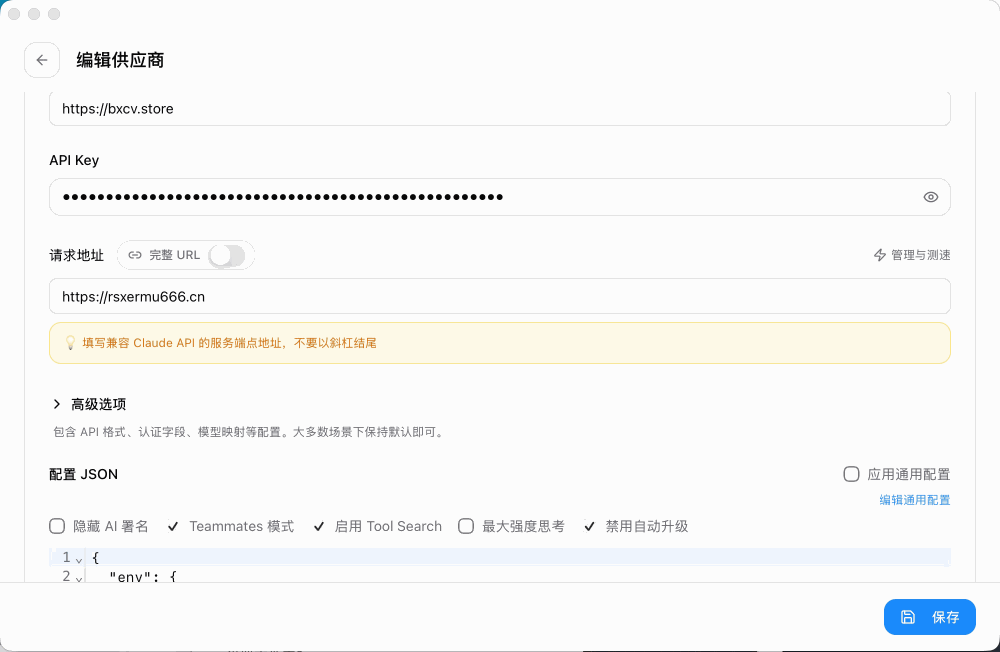
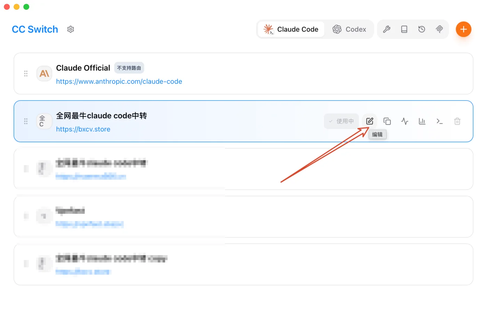
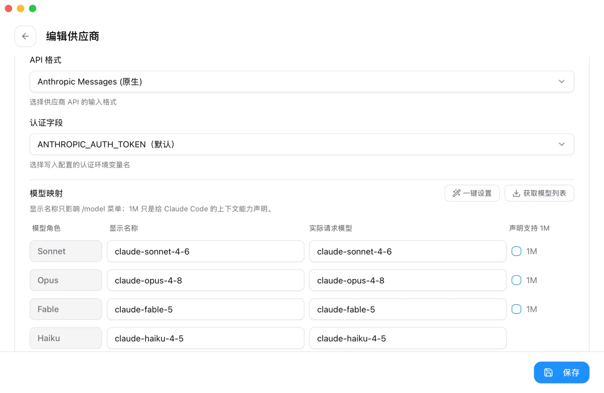
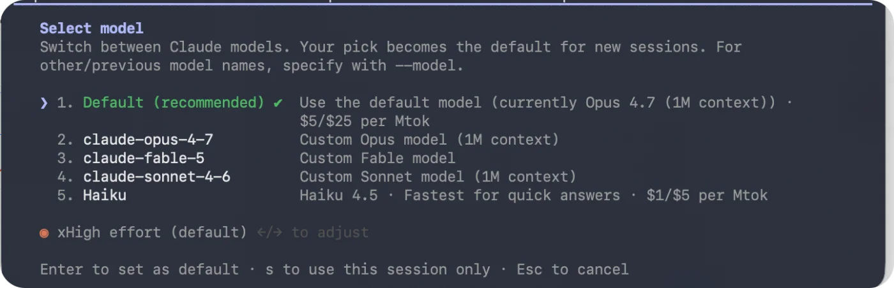
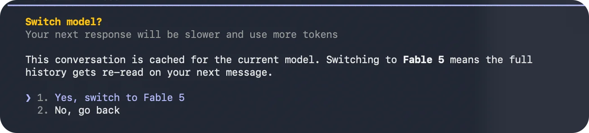
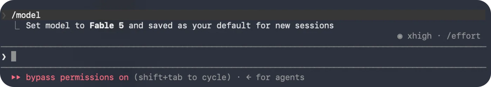
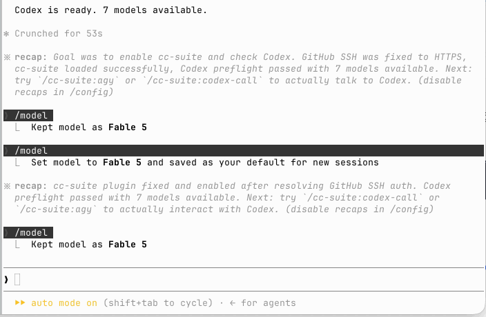
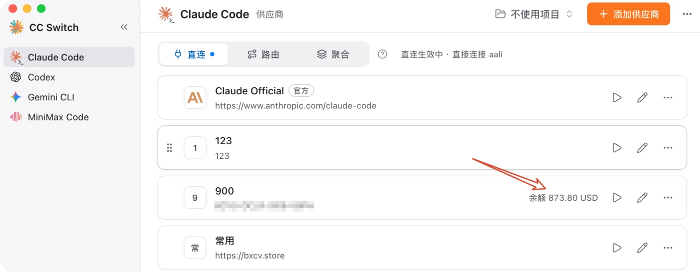
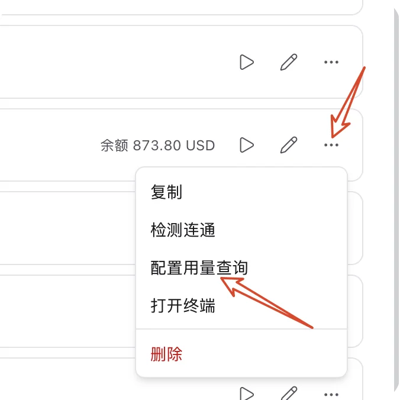
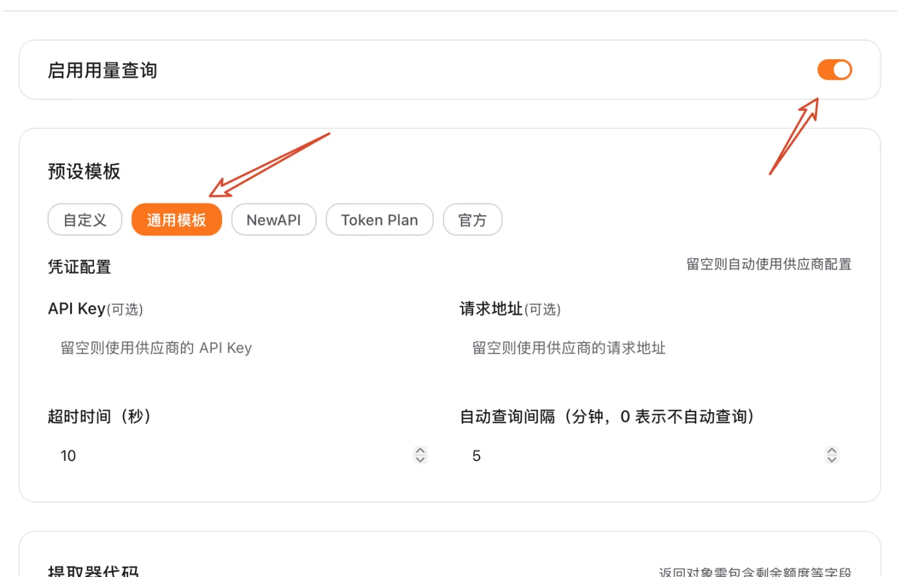

# 模型与用量

最后更新：2026-11-14


**所有链接都不用手机自带浏览器打开，都不用微信打开！！！**


加模型、关确认、查额度。前置：Claude Code 已经能用（见[安装](install.md)和[导入配置与续费](import.md)）。返回[总览](README.md)。

## 添加 fable-5

**视频教程链接：**

<https://v.douyin.com/WDwYe5cRVQ8/>




### 编辑 CC-Switch

打开 CC-Switch 编辑，并拉到下面输入：

`claude-fable-5`










### 切换模型

回到 Claude code，可以通过 `/model` 命令切换模型。











## 一直点 Yes 太麻烦

`claude --dangerously-skip-permissions`

## 在 CC-Switch 里配置用量查询

配置好以后的效果如图所示：

<figure><figcaption></figcaption></figure>

首先，我们可以点击 配置用量查询，然后，可以点击 启用用量查询，接着可以点击 通用模板 或 自定义

<div><figure><figcaption></figcaption></figure> <figure><figcaption></figcaption></figure></div>

接下来，只要将中转站的相关内容填写到下面的框体中即可，代码我放下面。

站点地址与激活码见[导入配置与续费](import.md)。

```javascript
({
  request: {
    url: "https://api.orbit1.lat/api/open/card/query",
    method: "POST",
    headers: {
      "Accept": "application/json",
      "Content-Type": "application/json"
    },
    body: JSON.stringify({
      card_key: "<你的激活码，需要手动替换>"
    })
  },

  extractor: function(response) {
    if (response.code !== 200 || !response.data) {
      return {
        isValid: false,
        invalidMessage: response.message || "查询失败"
      };
    }

    const data = response.data;
    const quota = data.quota || {};

    return {
      isValid: data.status === "active",
      invalidMessage: data.status_text || "卡密不可用",
      planName: data.product?.plan_name || "额度卡",
      remaining: Number(quota.remaining_usd),
      used: Number(quota.used_usd),
      total: Number(quota.total_usd),
      unit: "USD",
      extra: `请求次数：${quota.request_count ?? 0} 次`
    };
  }
})
```

<figure><figcaption></figcaption></figure>

填入后，点击测试脚本，若显示通过，则可以 保存配置。

旧版脚本已失效，留在[附录](appendix.md)备查。
