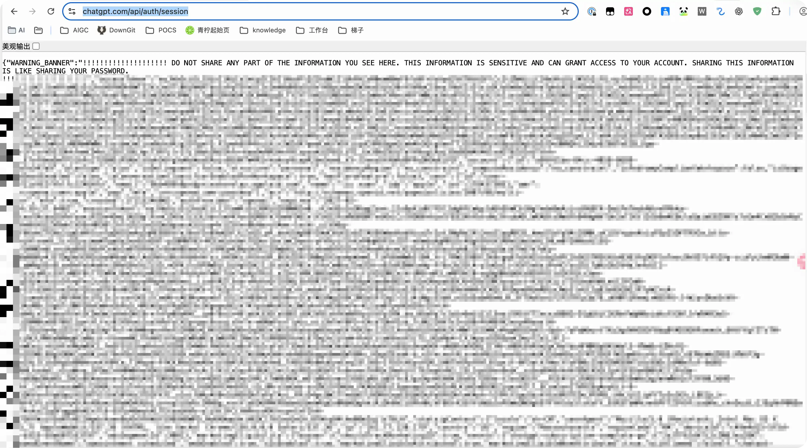
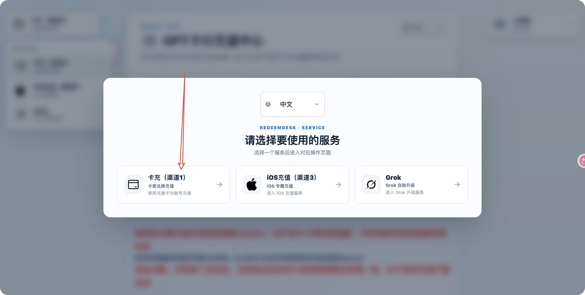
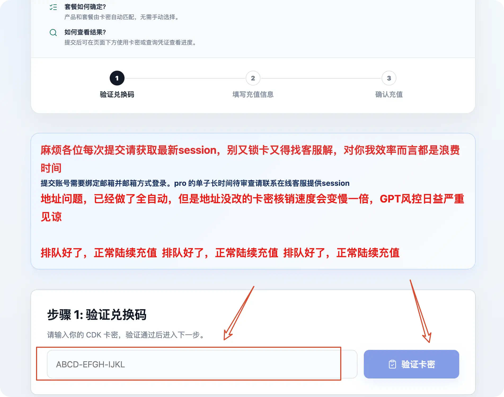

这里是 GPT 代充的教程，接下来，教程开始

## 获取 session

首先，你需要通过 <https://chatgpt.com/api/auth/session> 链接获取你的 session，大概长这个样子：

接下来，可以在浏览器里打开我交给你的链接，在里面输入我给你的激活码（可能在之前需要选择渠道，如果是普通一个月的 Plus 会员，可以选择 `渠道一 卡充`）



 






接下来，便可以在上图的图二位置，输入激活码。输入后点击 `验证卡密`，即可进入下一步，即 输入自己的 session

